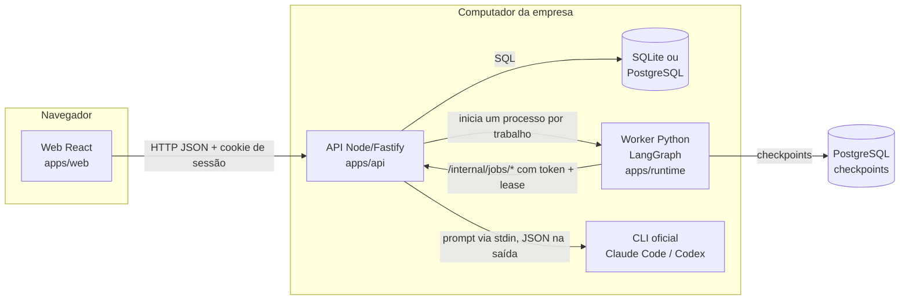
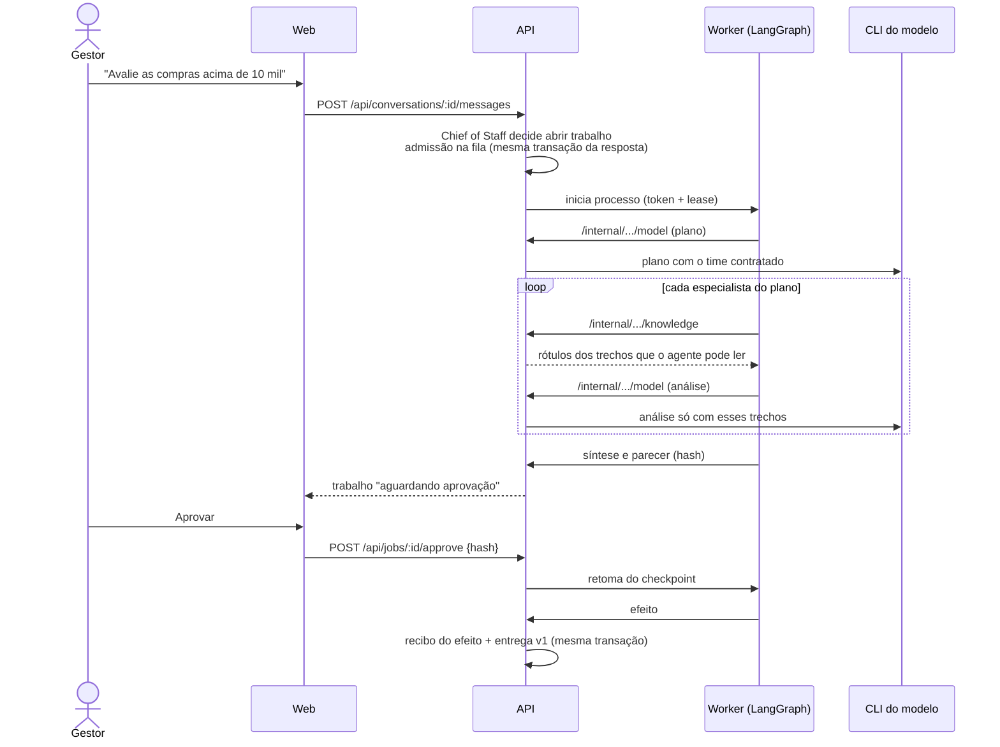
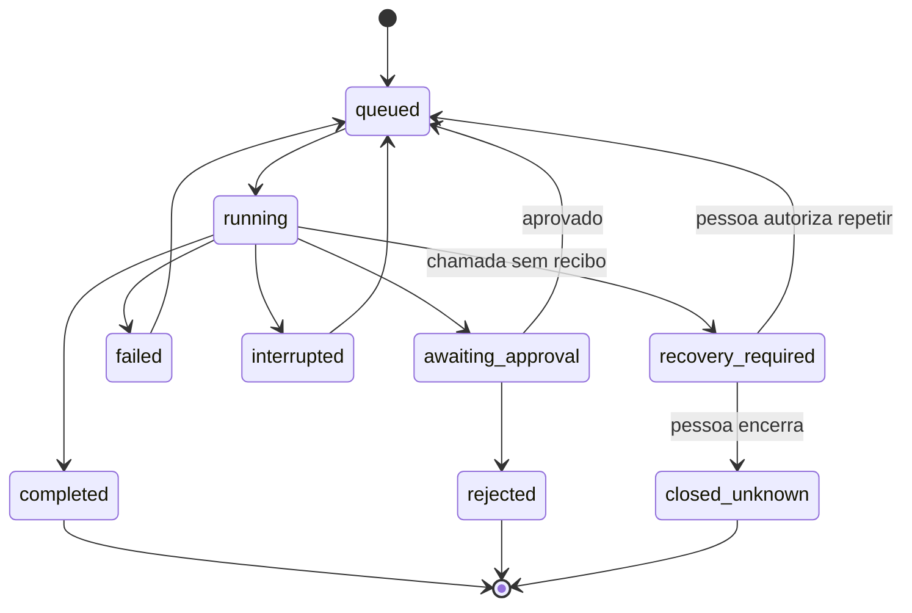
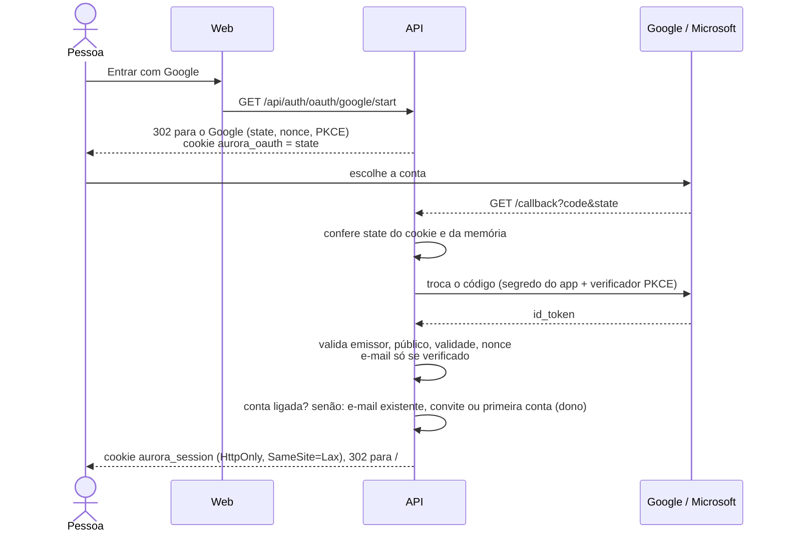

# Aurora v2 — arquitetura e fluxos

Documento técnico: como o Aurora é montado, por onde cada pedido passa e quais garantias o código
mantém. Para uma explicação sem jargão, veja o [Guia do Aurora](GUIA.md).

## 1. Visão geral

O Aurora é uma "empresa com IA": um **Chief of Staff** conversa com o gestor, monta trabalhos e
escala **agentes especialistas** contratados pela empresa. Os agentes leem só o **Cérebro** (os
documentos da empresa), sempre citando. Nenhuma ação sai da empresa sem **aprovação humana** do
parecer exato.



| Camada | Tecnologia | Papel |
| --- | --- | --- |
| Interface | React 19, Vite 8, TypeScript 7, Tailwind 4, shadcn/ui, TanStack Query 5, React Router 8 | Telas; nenhuma regra de negócio |
| API | Node 24 (TypeScript executado direto, sem build), Fastify 5, Zod 4 | Regras, estados, permissões, HTTP |
| Banco | SQLite (`node:sqlite`) ou PostgreSQL (`pg`), mesmo SQL | Tudo o que é da empresa |
| Worker | Python 3.13, LangGraph 1.2 com checkpoints em PostgreSQL | Ordem dos passos de um trabalho |
| Modelo | CLI oficial do Claude Code ou do Codex, já autenticada | Redigir planos, análises e respostas |

A API escuta só em `127.0.0.1`. O modelo roda com a conta do usuário na CLI do próprio
computador: o Aurora nunca lê nem guarda credenciais do provedor e não mede custo por chamada
(a execução por chave de API está planejada; veja Configurações › Execução dos agentes).

## 2. Organização do código

```
apps/api/src
  main.ts            ponto de entrada (lê config, monta o servidor)
  server.ts          raiz de composição: o único lugar que conhece as implementações concretas
  config.ts          variáveis AURORA_* validadas com Zod
  shared/            ids com marca, erros, relógio, JSON canônico
  platform/
    database/        contrato Sql, SQLite, PostgreSQL, migrations, UnitOfWork
    events/          trilha de eventos append-only (tabela `events`)
    http/            app Fastify (guardas, erros), interface estática
    model/           clientes das CLIs, limitador de chamadas
    workers/         supervisor dos processos de worker
  modules/<módulo>/
    domain/          regras puras (sem banco, sem HTTP)
    application/     casos de uso
    infrastructure/  repositórios SQL e adaptadores
    http/            rotas
apps/runtime/open_worker.py   grafo LangGraph do trabalho aberto
apps/web/src
  app/               layout, menu, rotas
  features/<área>/   uma pasta por tela
  components/ui/     componentes shadcn/ui
  lib/api.ts         cliente da API tipado
```

Regras que valem em todo módulo:

- **Dependência para dentro.** `domain` não importa nada de fora; `application` depende de
  interfaces; só `server.ts` liga as implementações.
- **Ids com marca** (`JobId`, `SourceId`, `ActorId`…): trocar um pelo outro é erro de compilação.
- **Um tipo de erro**, `AppError(kind, code, mensagem)`. O domínio diz o que aconteceu; o HTTP
  traduz o `kind` em status num único lugar (`platform/http/app.ts`).
- **UnitOfWork.** `uow.run(async (repos, tx) => …)` é tudo ou nada; `uow.join(tx)` deixa outro
  módulo escrever na mesma transação (por exemplo, a entrega gravada junto com o recibo do efeito).
- **Trilha de eventos.** Cada mudança relevante grava um evento num stream
  (`job:<id>`, `conversation:<id>`, `knowledge:<id>`, `access:<id>`…). Repetir o mesmo `eventId`
  com o mesmo conteúdo é aceito como repetição; com outro conteúdo, é recusado.

## 3. Módulos

| Módulo | Faz | Tabelas principais |
| --- | --- | --- |
| `accounts` | Contas, convites, sessões, login por senha/Google/Microsoft | `accounts`, `account_identities`, `account_invites`, `account_sessions` |
| `agents` | Empresa, catálogo de personas, time contratado, organograma, primeiro uso | `organization`, `agents` |
| `knowledge` | Cérebro: fontes, versões, vigência, revogação, áreas, busca híbrida (palavras + significado), perguntas com citação | `knowledge_sources`, `knowledge_versions`, `knowledge_areas`, `knowledge_embeddings` |
| `conversations` | Conversa com o Chief of Staff e Estação (conversa direta com um agente) | `conversations`, `conversation_messages` |
| `jobs` | Fila, estados do trabalho, aprovação, efeito, recibos, recuperação | `jobs`, `job_queue`, `admissions`, `effect_receipts` |
| `open-work` | Gateway do worker: plano, pesquisa por especialista, síntese, recibos de modelo | `inference_receipts` |
| `deliverables` | Entregas versionadas: aceite, pedido de ajuste, exportação | `deliverables`, `deliverable_versions`, `deliverable_reopenings` |
| `routines` | Pedidos recorrentes no fuso da instalação | `routines`, `routine_runs` |
| `integrations` | Catálogo, pasta local, Google Drive, Gmail e Slack, com permissões, cofre de tokens e trilha | `connections`, `connection_secrets`, `connection_items` |
| `recovery` | Central de recuperação: trabalhos com resultado desconhecido | (usa `jobs`) |
| `overview` | Command Center (o que decidir, andamento, problemas, consumo) e lista operacional dos agentes (`GET /api/agents/activity`) | (só leitura) |

As migrations ficam em `platform/database/migrations/{sqlite,postgres}/NNN_nome.sql`, uma pasta
por dialeto, aplicadas em ordem e cada uma numa transação. Um arquivo aplicado nunca é editado.

## 4. Fluxos

### 4.0 Composição do time e alçadas do Chief (N1)

- **Catálogo:** cada persona tem papel (`director`, `lead`, `specialist`); há um diretor por área.
  Contratar um diretor faz quem da área responde direto ao Chief passar a responder a ele; quem
  chega depois na área já entra respondendo ao diretor (`agents/application/staffing.ts`).
- **Alçadas** (`agents/domain/autonomy.ts`, tabela `chief_autonomy`, `GET/POST /api/autonomy`,
  Configurações): trazer agente que falta (nunca, propor, contratar sozinho), tipo de contratação
  (só para o trabalho ou permanente), agentes por trabalho (substitui o limite fixo de 3 no plano),
  áreas permitidas, ajustar e tirar do time.
- **Na conversa:** ao abrir trabalho, o Chief compara o pedido com o time (modelo: campo `hire`
  com ids do catálogo oferecido, o resto é descartado; regras: `suggestHires`, sobreposição de
  palavras com vantagem sobre o time). Em "propor", a resposta traz uma proposta
  (`staffing_proposals`) e o trabalho só abre quando o CEO decide
  (`POST /api/conversations/:id/staffing/:proposta/accept|decline`): aceitar contrata e abre na
  mesma transação; recusar abre com o time atual; repetir é inofensivo. Em "contratar sozinho",
  contrata e abre na mesma resposta. Tudo na trilha (quem decidiu e com qual regra).
- **Só para o trabalho:** o agente guarda `engagement = job` e o trabalho; quando o trabalho
  termina (concluído, rejeitado ou encerrado), sai do time (verificação a cada 30 s e ao subir), e
  quem respondia a ele passa a responder a quem ele respondia. O CEO contratar de novo o torna
  permanente.

### 4.1 Pedido na conversa até a entrega



Pontos que o código garante:

1. **O worker não manda texto.** Ele envia só o passo e rótulos. A API relê pedido, catálogo,
   trechos e saídas anteriores do banco e valida cada resposta do modelo contra um esquema.
2. **Recibo antes de chamar.** Cada chamada ao modelo é reservada no ledger antes e completada
   depois. Repetir o passo devolve o recibo, sem nova chamada. Uma reserva sem recibo depois de
   uma queda é **resultado desconhecido**: nunca se chama de novo sozinho; o trabalho vai para
   `recovery_required` e uma pessoa decide na Governança, com justificativa.
3. **Aprovação presa ao conteúdo.** O parecer tem um hash (trabalho + relatório + efeito). Aprovar
   com outro hash é recusado.
4. **Efeito uma única vez.** O efeito aprovado grava um recibo; repetir devolve o mesmo recibo. A
   entrega nasce na mesma transação do recibo: sem entrega, sem efeito.
5. **Retomada.** O LangGraph grava checkpoint em PostgreSQL a cada passo (`durability="sync"`).
   Se o processo cair, o próximo worker continua do último passo concluído; trabalho já aprovado
   e pausado na aprovação é retomado direto.

Estados do trabalho (`modules/jobs/domain/transitions.ts`):



### 4.2 Cérebro: envio, vigência e busca

- **Envio.** PDF, Word, texto, Markdown, CSV, JSON ou imagem (lida uma vez pelo modelo), ou um
  texto escrito no Aurora. Cada fonte tem área, dono, leitores, versões com data de vigência e pode
  substituir outra. Detalhes em [DADOS_CEREBRO_AGENTES.md](DADOS_CEREBRO_AGENTES.md).
- **Áreas.** "Geral", as áreas do catálogo de agentes (fixas) e as criadas pela empresa
  (`knowledge_areas`), que podem ser renomeadas e excluídas. O id vem do nome
  ("Jurídico & Compliance" → `juridico-compliance`) e não muda ao renomear; nome repetido é
  recusado; uma área só é excluída sem fonte em vigor (as revogadas voltam para "Geral"). Rotas:
  `POST /api/knowledge/areas`, `POST /api/knowledge/areas/:id` (renomear) e
  `POST /api/knowledge/areas/:id/remove`.
- **Vigência.** Vale a versão mais recente já em vigor; fonte substituída ou revogada sai das
  respostas na hora. O histórico fica guardado.
- **Busca.** Híbrida: BM25 sobre trechos (índice em memória reconstruído quando algo muda) somada
  à busca por significado com vetores guardados (`knowledge_embeddings`, modelo local; desligável
  com `AURORA_EMBEDDINGS=none`). Com três termos ou mais na pergunta, um trecho precisa conter pelo
  menos dois; trechos secundários só entram se forem comparáveis ao melhor. Sem evidência, a
  resposta se abstém.
- **Quem lê o quê.**
  - Pessoa: dono da fonte, leitores listados (e-mail da conta) ou `*` (toda a empresa).
  - Agente: fontes abertas a toda a empresa e as restritas com o leitor `agent:<id>`.
  - Agente respondendo a uma pessoa (Estação): só o que o agente **e** a pessoa podem ler.
- **Respostas.** Extrativas (frases dos trechos que contêm os termos da pergunta) ou redigidas
  pelo modelo, que só pode citar os trechos entregues; se o modelo falhar, volta ao extrativo.

### 4.3 Estação

A conversa com `agent_id` vai direto ao agente, sem abrir trabalho. O agente responde no papel
dele (persona e orientações da empresa no prompt de sistema, abaixo das regras de evidência), com
as fontes descritas acima, e as citações ficam gravadas na mensagem.

### 4.4 Rotinas

Diárias (com dias da semana) ou por intervalo, no fuso `AURORA_TIMEZONE`, com horário de verão.
Cada horário vira no máximo um trabalho: a execução é gravada na mesma transação da admissão, com
chave única por rotina e horário. Depois de uma parada, só o horário vencido mais recente dispara.
Recusa da fila vira nova tentativa com espera crescente, até desistir (aparece no Command Center).

### 4.5 Integrações

Conectores reais: **pasta local**, **Google Drive**, **Gmail** e **Slack**. Todos os externos
seguem a mesma interface (`modules/integrations/domain/adapter.ts`): navegar, trazer um item para
o Cérebro, conferir a revisão (barato) e, se tiver escrita, enviar uma entrega aceita.

- **Google (Drive e Gmail):** login na conta Google (OAuth com PKCE, acesso offline). Escopos
  mínimos: Drive só leitura + arquivos criados pelo Aurora; Gmail só leitura. Docs viram Word,
  Planilhas viram CSV, Apresentações viram texto; PDFs, Word e imagens são baixados como estão.
- **Slack:** token de bot de um app da empresa (o Slack não aceita retorno em `http://localhost`).
  Importa as mensagens recentes de um canal (com nomes e datas) e publica entregas num canal.
- **Cofre:** tokens cifrados com AES-256-GCM (`connection_secrets`); a chave fica fora do banco
  (`AURORA_SECRET_KEY` ou o arquivo `aurora.key` ao lado dos dados). Nenhum token sai pela API ou
  vai para a trilha. Desconectar apaga o token.
- **Sincronizar:** cada item importado fica ligado à fonte (`connection_items`). Sincronizar confere
  a revisão de cada um e só baixa o que mudou, que vira versão nova da mesma fonte.
- **Resiliência:** tempo limite e novas tentativas com espera crescente em 429/5xx; token de acesso
  renovado sozinho; acesso revogado marca a conexão (`reauth_required`) e a tela pede para
  reconectar.

A **pasta local** (serve pasta sincronizada de OneDrive, Google Drive ou
Dropbox): lê documentos para o Cérebro e grava entregas aceitas, só a versão aceita e sem
sobrescrever. Cada ação exige a permissão dada na conexão; o que não foi autorizado é recusado e
registrado. O caminho não pode sair da pasta, seguir atalhos nem apontar para os dados do Aurora.
SharePoint/OneDrive, WhatsApp Business, HubSpot e Webhook estão no catálogo como "em breve".

### 4.6 Acesso e login



- **Modos.** `AURORA_AUTH=accounts` (padrão) ou `local` (uso individual: todo pedido é do
  `operador-local`).
- **Primeira conta.** É do dono e, na mesma transação, assume o que era do operador local (dono e
  leitura de fontes, conversas). Depois dela, só entra quem o dono liberar (convite por e-mail).
- **Senha.** scrypt (N=2¹⁵, r=8, p=1) com sal; comparação em tempo constante; o mesmo trabalho é
  gasto quando a conta não existe. Cinco erros seguidos bloqueiam a senha daquele e-mail por cinco
  minutos (Google e Microsoft continuam entrando).
- **Sessão.** Token aleatório de 32 bytes no cookie; o banco guarda só o hash SHA-256. Vale 30
  dias. Suspender uma conta encerra as sessões dela.
- **Google/Microsoft.** OpenID Connect com código + PKCE, cliente confidencial. O `id_token` vem
  direto do endpoint de token por HTTPS, então as declarações são validadas sem baixar chaves
  (OIDC Core 3.1.3.7). Nenhum token de acesso é guardado. Na Microsoft, o e-mail só serve para
  ligar contas quando é garantido: conta pessoal, diretório configurado em
  `AURORA_MICROSOFT_TENANT` ou a declaração `xms_edov`.
- **Guarda da API.** Toda rota registrada sob `/api/` exige pessoa identificada, menos
  `/api/auth/*`. A guarda decide pelo **padrão da rota que atendeu** (`req.routeOptions.url`), não
  pelo texto da URL: o roteador decodifica a URL, então `/%61pi/jobs` também cai em `/api/jobs`.
  As rotas `/internal/*` são do worker e exigem o token dele e a concessão da execução.

## 5. Segurança da API

- Escuta só em loopback; aceita `Host` igual a `127.0.0.1:<porta>` ou `localhost:<porta>`
  (proteção contra DNS rebinding). Pedidos que mudam algo com `Origin` de outro site são recusados.
- Só JSON, em UTF-8 estrito, com limite de corpo por rota.
- Cabeçalhos: `no-store`, `nosniff` e uma CSP sem scripts de fora.
- O original de uma fonte nunca é servido como HTML: texto vai como texto puro e o resto como
  download, com sandbox.
- Erros desconhecidos viram 500 sem detalhes; o detalhe fica no log.

**Ponto aberto.** Os trabalhos são visíveis a todas as contas, e um agente pode usar uma fonte
restrita em que foi incluído. Então o relatório de um trabalho pode mostrar a quem não é leitor um
trecho de fonte restrita. A Estação já filtra pela pessoa que pergunta; nos trabalhos, falta
decidir a regra: trabalho visível só a quem pediu, ou trabalhos usando só fontes que todos os
participantes podem ler.

## 6. Interface

**Vistas** (como na v1): o Cérebro tem Lista e Mapa 3D; Agentes tem Lista operacional, Mapa 3D e
Organograma; o Jarvis é só o 3D dos agentes, em tela inteira, com a conversa do Chief por cima.
A vista fica no endereço (`/cerebro?vista=mapa`, `/agentes?vista=mapa|organograma`); o antigo
`/organograma` leva a `/agentes?vista=organograma`.

**Atividade dos agentes** (`GET /api/agents/activity`, em `overview/application/agent-activity.ts`):
modelo de leitura sem tabela própria. Junta o plano de cada trabalho recente (quem o Chief
designou) com os recibos de chamada ao modelo (`specialist:<id>` reservado = pesquisando, completo
= achados entregues). Status: disponível, designado, em execução, aguardando você (parecer pronto),
concluído ou parado (trabalho interrompido). Marcos do especialista: designado → pesquisa iniciada
→ achados entregues; do Chief: plano → especialistas → parecer. Tempo restante = mediana de pelo
menos três participações anteriores concluídas do mesmo agente, menos o já decorrido. A lista, o
organograma, o 3D e o Jarvis usam a mesma consulta (a cada 3 s enquanto alguém trabalha).

**Organograma em cartões** (`features/agents/org-chart.tsx`): posições de
`features/agents/org-layout.ts` (cada nível numa coluna ou linha, chefe centrado entre os
subordinados, ligações em cotovelo com seta; testado). Horizontal ou vertical, guardado no
navegador; abre centrado no Chief of Staff.

**Jarvis** (`features/jarvis/`): o Chief of Staff como assistente de quem dirige a empresa, logo
abaixo do gestor. Inspirado no projeto MIT [adewaskar/jarvis](https://github.com/adewaskar/jarvis)
(rosto e voz no navegador, cérebro separado), com código próprio e o visual do mapa da v2.

- **Cena:** o mapa de agentes em modo `immersive` e `bare`, com o núcleo trocado por um **reator**
  (`brain-map/reactor.tsx`): anel por shader polar (borda erodida por ruído, disco texturizado,
  marcas), dois anéis orbitais e poeira de partículas. Cor e pulso vêm da fase (em espera âmbar,
  ouvindo turquesa, processando laranja, respondendo creme) e do nível da voz, lidos por ref a cada
  quadro. A câmera deixa folga (`fit`) e a cena se centra entre o painel da esquerda e a conversa
  (`sceneInset`).
- **Voz** (`voice.ts`, regras em `voice-text.ts`, testadas): reconhecimento e síntese do próprio
  navegador (Chrome/Edge, pt-BR), sem chave nem serviço pago; o áudio não passa pelo Aurora. Um
  reconhecedor aberto enquanto a voz estiver ligada; palavra de ativação "Jarvis" (com o pedido na
  mesma frase), botão ou barra de espaço; falar enquanto ele responde interrompe; o que ele mesmo
  diz e volta pelo microfone é descartado como eco; "para"/"chega" cala. Esc volta à espera.
- **Painel (HUD):** hora no fuso da instalação, sistemas (Aurora, modelo, voz, Cérebro, time,
  integrações, rotinas), o que espera você agora (com links) e sugestões de pergunta.
- **Cérebro do Jarvis:** a conversa com o Chief (`Thread` reutilizado; a voz usa a mesma API). O
  Chief recebe a **situação da empresa** (`CompanyBriefing`, de `overview/application/briefing.ts`):
  pareceres aguardando aprovação, entregas para revisar, casos em recuperação, trabalhos andando com
  quem participa, quem do time trabalha agora e rotinas que desistiram. Por regras, responde a
  "o que espera minha aprovação?", "quem está trabalhando?", "resumo do dia" e andamento sem
  trabalho na conversa; com modelo, recebe a situação como dado (proibido inventar). Continua sem
  poder aprovar, enviar ou executar nada: abre trabalhos, e o parecer volta para a aprovação humana.
- Tela cheia pela Fullscreen API; o Jarvis usa toda a largura do app (as outras áreas ficam numa
  coluna legível).

**Mapa 3D**: three.js com React Three Fiber, carregado só quando aberto (o resto do app não paga o
peso do 3D). Dois modos: **Conhecimento** (núcleo → áreas → documentos, vigentes e históricos com
cores diferentes) e **Agentes** (núcleo Chief of Staff → áreas do time → agentes, aceso quem está
trabalhando ou aguardando você, ligado a quem responde a quem). Arrastar gira, rolar aproxima, clicar abre o documento
ou a Estação do agente. As posições vêm de `features/brain-map/layout.ts` (determinístico e testado);
a rotação automática pausa com o mouse sobre o mapa e não acontece se o sistema pedir menos
movimento; sem WebGL, a lista continua disponível. Os rótulos HTML ficam numa camada fixa sobre o
canvas (`portal` do drei): sem ela, o drei troca o elemento dos rótulos quando os eventos da cena
se conectam e o primeiro rótulo já desenhado fica vazio. A camada tem `z-0` para os rótulos (que o
drei sobe a um z-index enorme) não passarem por cima de painéis sobre o mapa.

**Padrões das telas** (em `components/common.tsx` e `components/ui/`), para todo CRUD ter a mesma
cara:

- `PageHeader` com título, descrição e a ação principal ("Nova rotina", "Adicionar ao Cérebro").
- Formulários com `Field` (rótulo, campo e dica); selects sempre com `NativeSelect`, que tem
  fundo sólido e opções nas cores do tema (com fundo transparente o Windows pinta a lista de branco
  e o texto do tema escuro some). O `:root` escuro usa `color-scheme: dark`.
- Detalhe ou edição em diálogo; salvar e cancelar no rodapé.
- Ação que não se desfaz (revogar, tirar do time, arquivar, excluir) numa `DangerZone` no fim, com
  `ConfirmAction`: o primeiro clique pede confirmação, o segundo executa.
- Alternância entre poucas vistas com `Segmented` (Lista / Mapa 3D).


- Todas as chamadas passam por `lib/api.ts`, que transforma `{ error, code }` em `ApiError` com a
  mensagem em português. Queda de conexão vira um aviso e a tela tenta de novo sozinha.
- `AuthGate` (em `features/access`) decide entre login, primeiro acesso e o app. Um 401
  `sign_in_required` fora de `/api/auth/` dispara o evento `aurora:signed-out`, que limpa o cache e
  volta para o login.
- Dados do servidor ficam no TanStack Query; cada tela invalida as chaves que muda.
- Tema escuro padrão, claro opcional; cores por tokens CSS.

## 7. Configuração

As variáveis `AURORA_*` são lidas uma vez e validadas em `config.ts`; o resto do código recebe um
`Config` tipado. As principais estão no [README](../README.md#como-rodar). Uma configuração
inválida impede a API de subir, com a lista dos problemas.

## 8. Testes e CI

- `npm run verify` roda tipagem, todos os testes e o build da interface.
- Os testes de repositório e de caso de uso rodam em **SQLite e PostgreSQL** quando
  `AURORA_TEST_POSTGRES_URL` está definida (`test/support/databases.ts` cria um esquema novo por
  teste).
- O modelo nunca é chamado de verdade nos testes: um executável falso
  (`test/fixtures/fake-open-model.ts`) imita a CLI, incluindo travamentos e saídas inválidas.
- `test/open-work.e2e.test.ts` sobe a API, o worker Python real e checkpoints em PostgreSQL, e
  derruba o processo no meio para provar a retomada.
- **Testes de interface** (`apps/web/e2e`, Playwright): `npm run test:ui` constrói a interface e
  sobe a API real (`e2e/serve.mjs`) com um SQLite descartável, sem login e sem modelo. Cobrem a
  abertura de cada área (computador e celular, sem erro no console e sem rolagem lateral), os
  selects legíveis no tema escuro, escrever fonte e perguntar com citação, o CRUD de áreas, criar e
  tirar agente, criar, pausar e arquivar rotina, o mapa 3D (todos os rótulos, inclusive o do
  núcleo), as três vistas de Agentes (lista, organograma horizontal/vertical, 3D) e o Jarvis
  (conversa, esconder/mostrar, tela cheia). Com `AURORA_E2E_SHOTS=<pasta>`, guardam capturas. Na máquina usam o Chrome instalado; no CI, o Chromium do Playwright
  (`PLAYWRIGHT_CHANNEL=chromium` força esse).
- O CI (`.github/workflows/ci.yml`) roda o mesmo `verify` com Node 24, Python 3.13 e PostgreSQL, e
  depois os testes de interface (relatório anexado quando falham).

## 9. Como estender

- **Nova persona no catálogo:** adicionar em `apps/api/data/agent-templates.json` (o arquivo é
  validado ao subir; área precisa existir, ids não se repetem).
- **Novo módulo:** criar `modules/<nome>/{domain,application,infrastructure,http}`, uma migration
  nova nos dois dialetos, os repositórios sobre `Sql`, e ligar em `server.ts`. Testes com
  `dialects`/`fresh` para cobrir os dois bancos.
- **Novo conector:** implementar o adaptador em `modules/integrations/infrastructure`, declarar as
  permissões no catálogo e passar toda ação pela guarda de permissão (que registra recusas).
- **Novo provedor de modelo:** implementar `ModelClient` (`platform/model/model-client.ts`) e
  escolher em `main.ts`.
