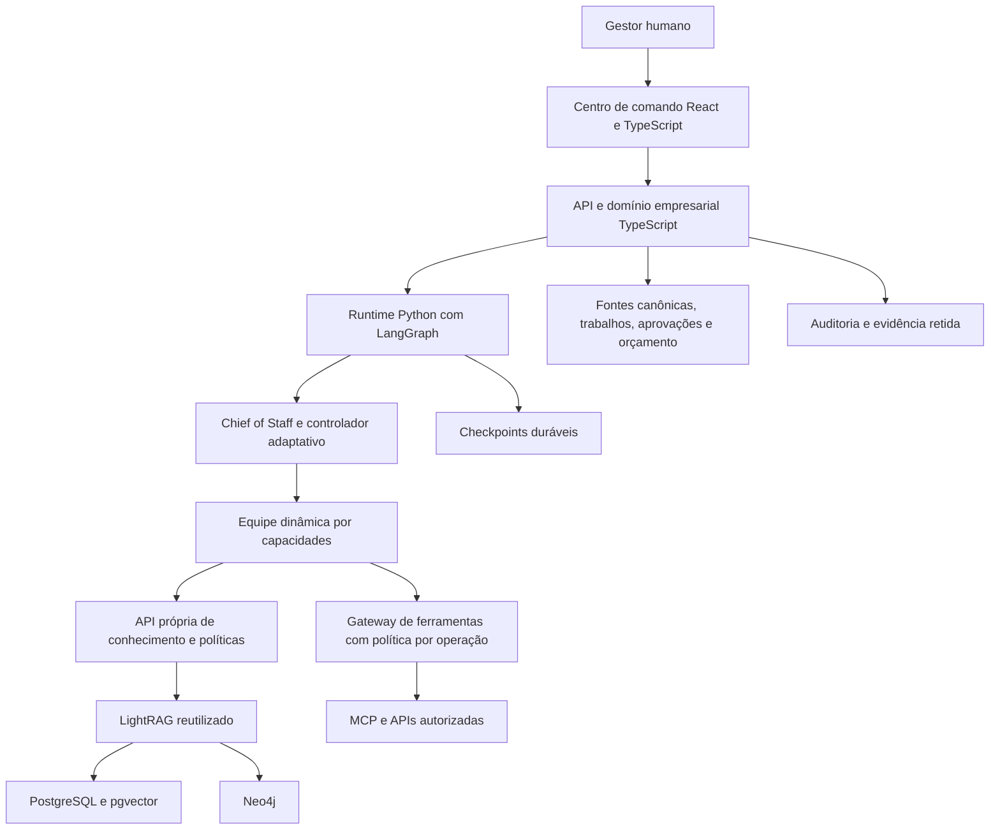

# Arquitetura de referência para desenvolvimento

Status: selecionada para construção; homologação de produção pendente. Origem: [dossiê](../poc/DOSSIER.md), decisões do usuário e [encerramento](ENCERRAMENTO_INVESTIGACAO.md). Não é declaração de que todos os blocos abaixo já estão implementados.

## Responsabilidades

É um mapa lógico; não exige um serviço/container por caixa. Uma instalação dedicada por empresa, mesmo código-base e configurações/integrações próprias. Domínios e departamentos são configuráveis, com um cérebro lógico central; não se multiplicam bancos por departamento por padrão.

**TypeScript empresarial:** identidades e grants, fontes/revisões/publicações, trabalhos e planos, permissões de ferramentas, aprovações, admissão/orçamento, resultados originais e auditoria. PostgreSQL é o alvo de persistência empresarial; migrar o ledger da fixture SQLite exige schema/migrations e testes próprios. Não alegar que essa migração já foi feita.

**LangGraph/Python:** execução e persistência dos workflows, Chief of Staff, controlador, composição das equipes e retomada. Somente LangGraph decide o avanço do workflow. Filas/transporte, adaptadores e serviços de inferência não se tornam agendadores concorrentes. Não adicionar Temporal, Kafka ou Redis sem necessidade medida.

**Conhecimento:** preservar fontes aprovadas por conteúdo exato; LightRAG mantém as projeções sem reimplementarmos seu motor. PostgreSQL/pgvector e Neo4j são o perfil inicial ensaiado, não promessa de backend único para sempre. Leitura passa pela fronteira de políticas e seleção de versão. História da fonte, dos fatos extraídos e da decisão são distintas; citações não substituem proveniência ou ACL.

**Efeitos e modelos:** adaptadores substituíveis, identidade explícita, autorização por destinatário/payload/tempo, reserva e recibos vinculados ao trabalho. Conta pessoal Codex não é requisito comercial do cliente. Inferência sem recibo não é reexecutada automaticamente. Ack HTTP não marca conclusão. Efeito real exige a política e a aprovação correspondentes.

**UI:** React/TypeScript e evolução do centro de comando JARVIS/Three.js. Grafo clicável representa trabalhos, agentes, fontes, capacidades e dependências com dados do backend. Estética futurista/3D permanece no escopo; não substitui informação operacional. Sem NestJS obrigatório; escolher/pinar dependências de implementação no bootstrap, sem nova pesquisa geral de stack.

## Requisitos preservados e rastreabilidade

| ID | Contrato do produto | Situação para desenvolvimento |
|---|---|---|
| R01 | Instalação por empresa; dados, segredos, execução, logs, políticas e orçamento isolados; sem cadastro público multi-tenant | Diretriz obrigatória de provisionamento e configuração |
| R02 | Um cérebro empresarial persistente com domínios configuráveis e colaboração transversal | LightRAG integrado em pequeno recorte; modelagem empresarial a construir |
| R03 | Busca híbrida/grafo, relações, citações e proveniência | Motor reutilizado; qualidade empresarial ainda a medir |
| R04 | Fontes canônicas revisadas, versões, vigência/publicação; histórias separadas de fatos e decisões | Contratos/testes editoriais reaproveitáveis; não transferir aprovação temporal ao Graphiti |
| R05 | Permissões nos servidores e em cada fronteira; histórico original com ACL atual | Evidência parcial; identidade empresarial e integração por operação a implementar |
| R06 | Gestor → Chief of Staff AI para planejamento, síntese, comunicação e acompanhamento | Requisito de produto pendente; não confundir com roteamento determinístico da fixture |
| R07 | Controlador adaptativo A0–A4: começa simples e escala por dependências, incerteza, risco, orçamento e paralelismo | Construção incremental; registrar estratégia e motivo; A4 completo não validado |
| R08 | Equipes dinâmicas por capacidades, sem cargos/departamentos fixos | Catálogo configurável; permanentes mediante aprovação e temporários dentro de limites prévios |
| R09 | Assessoramento e execução delimitada/autônoma com revisão humana conforme risco | MVP inicia em assessoramento e efeitos simulados; execução real depende de gate específico |
| R10 | Um owner de workflow, estado assíncrono honesto, checkpoints, cancelamento e recuperação | LangGraph escolhido; completar contratos do produto e janelas de falha |
| R11 | MCP/APIs autorizadas, credenciais fora de código não confiável, sandbox e menor privilégio | Gateway/executor a homologar; ferramentas falsas claramente rotuladas no desenvolvimento |
| R12 | Idempotência de intenção/efeito, recibos, fencing, lease/heartbeat, unknown sem sucesso ou reexecução presumidos | Ensaios parciais passaram; heartbeat automático e novas categorias de recuperação pendentes |
| R13 | Orçamento por trabalho/múltiplos agentes; consumo de ingestão, consulta, retries, falhas e conciliação | Unidades sintéticas/tokens observados; custo monetário e limites atribuíveis a implementar |
| R14 | Backup e atualidade de fontes/ACL/diário/índices/chaves; restauração não reautoriza histórico obsoleto | Restore frio limitado demonstrado; DR externo, PITR/HA e upgrade pendentes |
| R15 | Observabilidade: sucesso correto/seguro, p50/p95, custo por entrega, intervenções, loops, retrabalho, erros e decisões do controlador | Instrumentar o produto; não promover amostras pequenas a SLO empresarial |
| R16 | Logs sem segredos/PII/conteúdo confidencial; telemetria isolada por cliente | Política e verificação em cada adaptador |
| R17 | JARVIS visual funcional, futurista/3D, grafo vivo e clicável | Requisito mantido; primeira versão pode ser incremental com o mesmo modelo operacional |
| R18 | Reutilizar motores prontos, TypeScript empresarial + Python IA, sem reconstruir bibliotecas inteiras | Arquitetura mantida; adaptar contratos de negócio, não clonar plataformas completas |
| R19 | Obsidian/Markdown como edição opcional; API própria não dependente do aplicativo | Compatibilidade de Vault existente; UI Obsidian não homologada |
| R20 | Dimensionar para empresa grande e testar primeiro cenários menores | Testes progressivos; volume/SLO reais serão definidos antes do piloto correspondente |
| R21 | Comercialização com licença/ativos/dependências adequados e provedor independente de conta pessoal obrigatória | Revisão de distribuição/contratos antes de entrega comercial |

A0 = chamada direta; A1 = agente com ferramentas/memória; A2 = workflow modular; A3 = equipe limitada; A4 = escolha adaptativa entre estratégias. Uma tarefa simples não converte a plataforma inteira em um chatbot single-agent. CEO/CFO/CMO/departamentos citados no dossiê são exemplos, não esquema rígido.

## Base técnica rastreável

Partir dos SHAs ensaiados: LangGraph `3c916d750575b22c464790e9774494d810ccd322` (1.2.19); LightRAG `aaebfe1bb8d55deb6a4304d357a3bf4c92fcd40a` (1.5.8). [Ambiente completo](../validation/detached-inference/environment.json) fixa checkpoint, drivers, imagens e pesos ONNX. Isso é referência de desenvolvimento, não congelamento eterno nem aprovação de upgrades automáticos.

Keycloak é candidato preferencial já investigado para identidade; SSO/federação/MFA/JWKS/TLS continuam trabalho de integração e homologação. Graphiti, Glean, ServiceNow e frameworks de colaboração não integram implicitamente a base. Nenhuma decisão aqui aprova licença/ativos de um projeto JARVIS de terceiros sem revisão.
