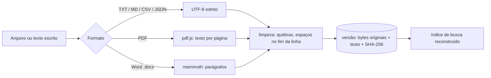
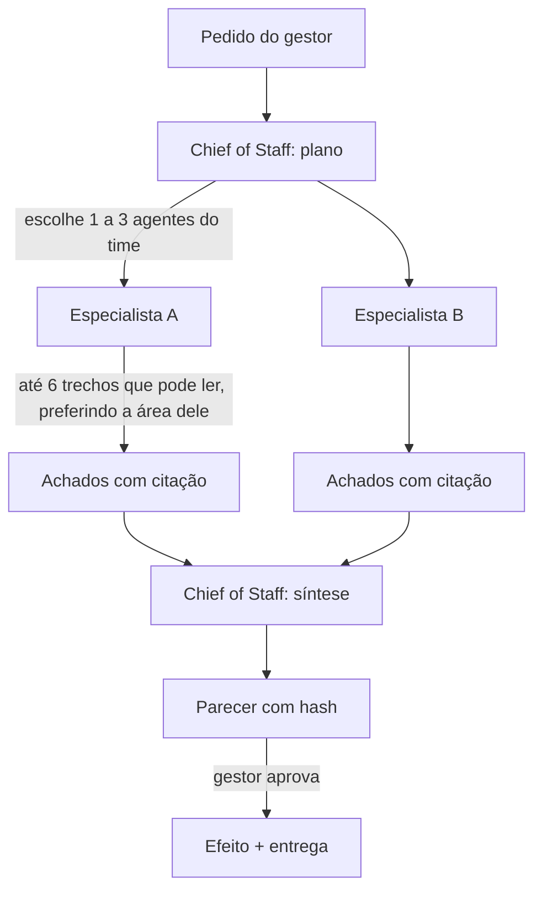

# Dados, Cérebro e orquestração dos agentes

Como o Aurora guarda as coisas, como lê os documentos, como acha o trecho certo, como recupera
depois de uma queda e como os agentes trabalham juntos. No fim, o que cada um dos 69 agentes faz.
Visão geral da arquitetura em [ARQUITETURA.md](ARQUITETURA.md); explicação sem jargão em
[GUIA.md](GUIA.md).

## 1. Onde tudo fica

Tudo o que é da empresa fica **num único banco**: SQLite (`apps/api/data/aurora.db`, padrão) ou
PostgreSQL (`AURORA_DATABASE_URL`). Os dois usam o mesmo SQL; as diferenças ficam nas migrations
(`apps/api/src/platform/database/migrations/<dialeto>/`). Nada vai para a nuvem do Aurora: não há
nuvem do Aurora.

| O quê | Tabela | Observação |
| --- | --- | --- |
| Fontes do Cérebro | `knowledge_sources` | título, dono, leitores, **área**, substituição, revogação |
| Vetores dos trechos | `knowledge_embeddings` | busca por significado; um vetor por modelo e texto (hash), recalculado só se o texto mudar |
| Versões de cada fonte | `knowledge_versions` | **arquivo original (bytes)**, **texto extraído**, formato, **origem** (arquivo ou texto escrito), SHA-256, vigência |
| Conversas e mensagens | `conversations`, `conversation_messages` | mensagens com citações gravadas |
| Trabalhos | `jobs`, `job_queue`, `admissions` | pedido, plano, parecer, aprovação, recibo |
| Recibos | `effect_receipts`, `inference_receipts` | um por efeito e um por chamada ao modelo |
| Entregas | `deliverables`, `deliverable_versions`, `deliverable_reopenings` | versões aceitas e pedidos de ajuste |
| Empresa e time | `organization`, `agents` | quem foi contratado, orientações, a quem responde |
| Rotinas | `routines`, `routine_runs` | uma execução por horário |
| Integrações | `connections` | pasta local e permissões |
| Trilha | `events` | tudo o que aconteceu, por stream, só acrescenta |
| Checkpoints do worker | esquema do LangGraph no PostgreSQL (`AURORA_CHECKPOINT_DSN`) | estado do grafo a cada passo |

**Cópia de segurança:** com SQLite, copiar `aurora.db` com a API parada é uma cópia completa
(inclui os arquivos originais). Com PostgreSQL, `pg_dump` do banco e do esquema dos checkpoints.

## 2. Envio ao Cérebro

- **Formatos:** TXT, Markdown, CSV, JSON, PDF e Word (.docx). O tipo vem do navegador ou da
  extensão. PDF escaneado (só imagem) não tem texto e é **recusado com orientação**, em vez de
  entrar vazio. PDF com senha ou danificado também é recusado.
- **Texto escrito:** a aba "Escrever texto" grava uma versão Markdown com origem `text` e nome
  gerado do título (`politica-de-reembolso.md`). Títulos com `#` viram seções.
- **Original preservado:** cada versão guarda os bytes exatamente como chegaram. A citação abre
  esse original. Texto vai como texto puro; PDF e Word vão como download, nunca dentro da página.
- **Área:** cada fonte pertence a uma área (as mesmas do catálogo de agentes, mais "Geral") e pode
  mudar de área sem criar versão nova.
- **Versões e vigência:** versão nova não apaga a anterior; vale a mais recente cuja data já
  chegou. "Substitui" tira a fonte antiga das respostas. Revogar tira na hora e mantém o histórico.
- **Limites:** tamanho máximo por arquivo em `AURORA_KNOWLEDGE_MAX_BYTES` (padrão 5 MB). Mesmo
  conteúdo da última versão é recusado (SHA-256 igual).
- **Pasta local:** o conector lê os mesmos formatos da pasta e envia ao Cérebro pelo mesmo caminho.

### Imagens e anexos

- **Imagem vira fonte.** PNG, JPG, WEBP e GIF são lidos **uma única vez**, no envio, pelo modelo com
  visão (Claude Code ou Codex, na sua conta). Ele transcreve o texto visível (tabelas viram
  tabelas Markdown) e descreve em 1 a 3 frases o que a imagem mostra, sem deduzir nada. A
  transcrição é o texto da versão; a imagem original fica guardada e a citação abre a imagem.
  Perguntar depois não lê a imagem de novo (rápido e não gasta cota).
- **Sem modelo configurado**, imagem é recusada com orientação. Se o modelo falhar ou a cota
  acabar, nada é guardado pela metade e a mensagem diz o que aconteceu.
- **Conferência do arquivo:** PDF, Word e imagens têm os primeiros bytes conferidos; arquivo
  renomeado (um texto chamado `.png`) é recusado. SVG não é aceito.
- **Anexo na conversa:** até 4 arquivos por mensagem (imagens ou documentos). Cada um vira fonte do
  Cérebro (área Geral, aberta à empresa; dá para mudar depois) **antes** de a mensagem ser
  gravada. Se o Chief of Staff abrir um trabalho, as fontes anexadas ficam gravadas no trabalho
  (`jobs.attachments`) e **cada especialista recebe primeiro os trechos delas** (até 4), além dos
  da busca; na Estação, o agente também recebe os anexos primeiro. Reenviar a mesma mensagem
  (mesma `client_message_id`) não guarda nem lê os anexos de novo.

## 3. Recuperação da informação (busca)

1. **Trechos.** O texto é dividido em trechos de até 800 caracteres:
   - respeitando parágrafos e frases;
   - cada **título abre um trecho novo** e o trecho guarda a **seção** em que está;
   - **CSV**: grupos de linhas, sempre com o cabeçalho na frente, para o trecho se explicar sozinho.
2. **Índice.** BM25 em memória sobre `título da fonte + seção + texto`. Termos sem acento, em
   minúsculas, sem palavras vazias e no **singular** (fornecedores → fornecedor, ações → ação).
   O índice é refeito quando algo muda (envio, versão, área, revogação, leitores) ou quando uma
   versão futura entra em vigor.
3. **Filtros antes da pontuação:** acesso de quem pergunta (ou do agente), vigência, revogação,
   substituição e, se pedido, **só uma área**.
4. **Evidência mínima.** Com 3 termos ou mais na pergunta, o trecho precisa ter pelo menos 2.
   Trechos secundários só entram com pontuação de pelo menos metade da do melhor. Sem trecho, a
   resposta é **abstenção**.
5. **Preferência de área.** Para um agente, trechos da área dele ganham 30% de peso: o analista de
   compras acha primeiro o manual de compras, sem perder uma política Geral melhor.
6. **Por significado (híbrida).** Com `AURORA_EMBEDDINGS=local` (padrão), cada trecho também vira
   um vetor no modelo `multilingual-e5-small`, que roda no próprio computador (baixado uma vez do
   Hugging Face, cerca de 118 MB, para `apps/api/data/models`). A pergunta vira vetor e os trechos
   mais parecidos entram numa segunda lista. As duas listas (palavras e significado) são juntadas
   por posição (RRF, k=60): quem aparece nas duas sobe.
   - **Quando um trecho achado só pelo significado vale como evidência.** O E5 dá similaridade
     alta a quase tudo (0,80–0,88), então um corte fixo não separa: na calibração, "Qual o CNPJ da
     empresa?" (sem resposta) deu 0,833 e uma resposta certa deu 0,829. O que separa é o
     **destaque**: o quanto o trecho fica acima da média de todos. Vale se o destaque for de pelo
     menos 0,025 (`AURORA_SEMANTIC_GAP`, com 5 trechos ou mais para comparar) ou se a
     similaridade for de pelo menos 0,86 (`AURORA_SEMANTIC_MIN`). Sem isso, abstenção.
   - **Resultado da calibração** (8 documentos, 9 perguntas com outras palavras e 5 sem resposta):
     só palavras acertou 3 de 9; híbrida acertou 8 de 9, sem resposta errada e sem inventar nas 5
     sem resposta. O teste `semantic-quality.test.ts` repete essa avaliação sempre que o modelo
     está baixado, para nenhuma mudança piorar a busca.
   - **Velocidade** (CPU comum): carregar o modelo ~1 s (feito ao subir a API), vetorizar ~17 ms
     por trecho de 500 caracteres, pergunta híbrida ~5 ms, comparar 50 mil trechos ~55 ms com
     ~77 MB de memória. Vetores de perguntas recentes ficam em cache.
   - Vetorizar acontece em segundo plano depois de cada mudança; enviar um arquivo continua rápido.
   - Os vetores ficam no banco: reiniciar não recalcula nada.
   - Se o modelo falhar, a busca segue só por palavras e a tela do Cérebro avisa.
7. **Resposta.** Extrativa (as frases do trecho que têm os termos da pergunta) ou redigida pelo
   modelo, que só pode citar os trechos entregues. A citação mostra fonte, seção, versão e link.

Próximos ganhos possíveis: um reordenador (cross-encoder) depois da fusão e um índice vetorial no
banco (pgvector) se o volume passar de dezenas de milhares de trechos; hoje a comparação é feita
em memória, o que é rápido nesse tamanho.

## 4. Recuperação depois de uma falha

| Situação | O que acontece |
| --- | --- |
| Worker cai no meio | O LangGraph salvou o último passo concluído; o próximo worker continua dali (`durability="sync"`) |
| API reinicia | `reconcileOnRestart` revê trabalhos em execução: sem processo vivo, voltam à fila ou vão para revisão |
| Chamada ao modelo sem recibo | Resultado desconhecido: o trabalho vai para `recovery_required`; nada é chamado de novo sozinho |
| Pessoa decide na Governança | "Repetir" (com justificativa e os passos escolhidos) ou "Encerrar"; fica na trilha |
| Efeito já executado | O recibo existe; repetir devolve o mesmo recibo, sem efeito duplicado |
| Rotina perdeu horários | Só o horário vencido mais recente dispara; cada horário vira no máximo um trabalho |
| Cota do modelo esgotada / CLI ausente | O erro aparece no Command Center; trabalho falha de forma sabida e pode voltar à fila |

## 5. Orquestração dos agentes

- **Plano.** O Chief of Staff recebe o pedido e o time contratado (título, foco e **o que cada um
  faz**) e escolhe de 1 a 3 agentes, com uma justificativa. Agente fora do time é recusado.
- **Especialista.** Cada um recebe só o pedido e até 6 trechos que pode ler (fontes abertas e as
  restritas liberadas para ele), com preferência pela própria área. O prompt diz o papel (o que
  ele faz) e as orientações da empresa; as regras de evidência vêm depois e prevalecem. Cada achado
  precisa citar rótulos de trechos entregues; sem evidência, ele diz o que falta.
- **Síntese.** O Chief of Staff junta os achados num parecer curto, só com o que foi citado; aponta
  contradições e se abstém quando não dá para recomendar.
- **Aprovação e entrega.** O parecer tem hash; aprovar outro conteúdo é recusado. O efeito aprovado
  gera a entrega na mesma transação.
- **Estação.** Conversa direta com um agente: ele responde no papel dele, com as fontes que ele **e**
  a pessoa podem ler, sem abrir trabalho.
- **Uma chamada por vez.** As chamadas ao modelo passam por um limitador (1 por vez, fila de 4): a
  cota é a da sua assinatura.

## 6. Os agentes

Cada agente do catálogo tem: nome e cargo, uma frase, foco, **o que faz** (usado pelo Chief of
Staff para escolher e entregue ao agente como papel) e **o que entrega**. Dá para contratar,
ajustar as orientações, definir a quem responde e criar agentes próprios. O catálogo é o arquivo
`apps/api/data/agent-templates.json`, validado quando a API sobe.

### Gestão & Estratégia (6)

**Helena — Especialista em gestão de projetos** (`project_manager`)  
_Mantém as entregas no trilho e os riscos à vista._  
Faz: Quebra objetivos em entregas, marcos e responsáveis; Mapeia dependências entre áreas e o caminho crítico; Acompanha prazos e sinaliza atrasos antes que virem problema; Mantém um registro de riscos com dono e plano de resposta.  
Entrega: Plano de projeto com marcos, Relatório de status semanal, Matriz de riscos.

**Rafael — Analista de negócios** (`business_analyst`)  
_Traduz prioridades de negócio em decisões claras._  
Faz: Levanta requisitos com as áreas e traduz em regras claras; Desenha o processo atual e o proposto; Compara alternativas com custo, prazo e impacto; Define critérios para saber se a mudança deu certo.  
Entrega: Documento de requisitos, Mapa de processo atual x proposto, Análise de alternativas.

**Marina — Analista de portfólio** (`portfolio_analyst`)  
_Investe a energia da empresa onde rende mais._  
Faz: Reúne as iniciativas em andamento e o que cada uma consome; Compara retorno esperado, esforço e alinhamento à estratégia; Aponta sobreposições e iniciativas que podem parar; Propõe a ordem de prioridade do próximo ciclo.  
Entrega: Mapa do portfólio, Ranking de prioridades, Recomendação de cortes e reforços.

**Alberto — Consultor de estratégia** (`strategy_advisor`)  
_Ajuda a escolher onde jogar e como ganhar._  
Faz: Analisa mercado, concorrência e forças da empresa; Monta cenários e o que muda em cada um; Revisa o modelo de negócio e as fontes de receita; Transforma a estratégia em poucas prioridades anuais.  
Entrega: Análise SWOT e de cenários, Plano estratégico anual, Prioridades com metas.

**Débora — Especialista em metas e OKRs** (`okr_specialist`)  
_Faz todo mundo remar na mesma direção._  
Faz: Ajuda a definir objetivos claros e resultados-chave mensuráveis; Desdobra metas da empresa para cada área; Monta os rituais de acompanhamento; Aponta metas sem dono, sem número ou contraditórias.  
Entrega: OKRs da empresa e por área, Painel de indicadores, Roteiro dos rituais de gestão.

**Nicolas — Analista de mercado e concorrência** (`market_intelligence_analyst`)  
_Sabe o que o concorrente fez ontem._  
Faz: Organiza o que se sabe sobre concorrentes, preços e posicionamento; Estima o tamanho do mercado e os segmentos; Acompanha tendências do setor; Compara a empresa com referências (benchmarks).  
Entrega: Mapa da concorrência, Estudo de mercado, Relatório de tendências.

### Marketing & Conteúdo (13)

**Lívia — Especialista em conteúdo** (`content_specialist`)  
_Conta a história da marca com consistência._  
Faz: Planeja pautas a partir dos objetivos e do público; Escreve artigos, materiais ricos e roteiros; Adapta um conteúdo para vários canais; Mantém o tom de voz da marca.  
Entrega: Calendário de conteúdo, Artigos e materiais, Guia de tom de voz.

**Diego — Planejador de campanhas** (`campaign_planner`)  
_Planeja campanhas com público e limite definidos._  
Faz: Define objetivo, público, oferta e mensagem da campanha; Escolhe canais e distribui o orçamento; Monta o cronograma de peças e ações; Define as métricas de sucesso e o acompanhamento.  
Entrega: Plano de campanha, Cronograma de peças, Metas e indicadores.

**Camila — Analista de preço comercial** (`pricing_analyst`)  
_Preço certo, promoção que fecha a conta._  
Faz: Compara preços com custos, margem e concorrência; Simula descontos, combos e promoções; Propõe faixas e políticas de preço; Avalia o efeito de reajustes no volume.  
Entrega: Tabela de preços recomendada, Simulação de cenários de preço, Política de descontos.

**Bianca — Copywriter** (`copywriter`)  
_Transforma a oferta em texto que convence._  
Faz: Escreve textos de venda: anúncios, páginas, e-mails e legendas; Cria títulos e chamadas para ação em várias versões para teste; Ajusta o texto ao público e à etapa do funil; Revisa clareza, tom e promessa da oferta.  
Entrega: Textos de anúncio com variações, Página de venda, Legendas e e-mails.

**Júlia — Social media (Instagram e redes)** (`social_media_manager`)  
_Mantém as redes vivas, com calendário e constância._  
Faz: Monta o calendário editorial das redes; Planeja posts, carrosséis, stories e reels para Instagram, TikTok e LinkedIn; Escreve legendas e sugere horários e hashtags; Lê o desempenho e ajusta a linha editorial.  
Entrega: Calendário mensal das redes, Roteiro de posts e reels, Relatório de engajamento.

**Caio — Gestor de tráfego pago** (`paid_traffic_manager`)  
_Põe a verba onde o cliente está._  
Faz: Planeja campanhas no Meta Ads e no Google Ads; Define públicos, orçamento e lances; Propõe criativos e testes A/B; Acompanha CPA, ROAS e corta o que não dá retorno.  
Entrega: Plano de mídia com orçamento, Estrutura de campanhas e públicos, Relatório de desempenho com recomendações.

**Manuela — Designer de marca e peças** (`brand_designer`)  
_Faz a marca ser reconhecida de longe._  
Faz: Cuida da identidade visual e da consistência da marca; Escreve briefings de peças para posts, anúncios e materiais; Define direção de arte: cores, tipografia, imagens; Revisa peças contra o guia de marca.  
Entrega: Briefing de peças, Guia de marca, Revisão de peças com ajustes.

**Henrique — Especialista em SEO** (`seo_specialist`)  
_Faz o cliente encontrar você no Google._  
Faz: Pesquisa palavras-chave e a intenção de busca; Propõe a estrutura de conteúdo do site e do blog; Revisa títulos, descrições e textos das páginas (SEO on-page); Acompanha posições e tráfego orgânico.  
Entrega: Mapa de palavras-chave, Pauta de blog priorizada, Checklist de SEO por página.

**Letícia — Especialista em e-mail marketing e CRM** (`email_marketing_specialist`)  
_Conversa com a base no momento certo._  
Faz: Segmenta a base de clientes e contatos; Desenha réguas de relacionamento (boas-vindas, recompra, reativação); Escreve newsletters e mensagens de WhatsApp; Acompanha abertura, cliques e conversão.  
Entrega: Régua de relacionamento, Calendário de envios, Textos de e-mail e mensagem.

**Arthur — Roteirista de vídeo** (`video_scriptwriter`)  
_Prende a atenção nos três primeiros segundos._  
Faz: Escreve roteiros de reels, vídeos curtos e YouTube; Cria ganchos para os primeiros segundos; Estrutura narrativa, cenas e chamada final; Adapta o roteiro para anúncio em vídeo.  
Entrega: Roteiros com cenas e falas, Banco de ganchos, Roteiro de anúncio em vídeo.

**Valentina — Estrategista de marca** (`brand_strategist`)  
_Define o que a marca promete e para quem._  
Faz: Define posicionamento e proposta de valor; Descreve personas e o que cada uma precisa ouvir; Organiza a arquitetura de mensagens da marca; Compara a marca com a concorrência para achar diferenciais.  
Entrega: Plataforma de marca, Personas, Mensagens-chave por público.

**Samuel — Analista de performance de marketing** (`marketing_analyst`)  
_Mostra o que dá retorno e o que é só barulho._  
Faz: Monta o funil de marketing e mede cada etapa; Calcula CAC, conversão e retorno por canal; Atribui resultados às campanhas certas; Aponta onde investir mais e onde cortar.  
Entrega: Painel de marketing, Relatório mensal por canal, Recomendação de verba.

**Yasmin — Especialista em influenciadores e parcerias** (`influencer_specialist`)  
_Encontra quem fala com o seu público._  
Faz: Seleciona criadores que falam com o público da marca; Propõe formatos de parceria, permuta e cachê; Escreve o briefing da publicidade; Acompanha alcance e vendas geradas.  
Entrega: Lista de criadores avaliados, Proposta e briefing de parceria, Relatório de resultados.

### Vendas (5)

**Leonardo — Analista de operações comerciais** (`sales_operations_analyst`)  
_Pipeline limpo, previsão confiável._  
Faz: Organiza o funil de vendas e as etapas do CRM; Acompanha metas, conversão e ciclo de venda; Calcula comissões e previsões de receita; Aponta gargalos e oportunidades paradas.  
Entrega: Painel comercial, Previsão de vendas, Relatório de funil.

**Vanessa — Especialista em contas e propostas** (`account_specialist`)  
_Propostas que fecham e compromissos que se cumprem._  
Faz: Prepara propostas comerciais sob medida; Organiza o histórico e as necessidades de cada conta; Identifica oportunidades de venda adicional; Acompanha renovações e riscos de perda.  
Entrega: Propostas comerciais, Plano de conta, Mapa de renovações.

**Igor — Pré-vendas (SDR)** (`sdr`)  
_Enche a agenda dos vendedores com conversas boas._  
Faz: Monta listas de prospecção por perfil de cliente ideal; Escreve cadências de contato por e-mail, telefone e LinkedIn; Qualifica leads com critérios claros; Agenda reuniões para os vendedores.  
Entrega: Lista de prospecção, Cadência e scripts de abordagem, Critérios de qualificação.

**Fábio — Executivo de vendas** (`account_executive`)  
_Leva a negociação até o sim._  
Faz: Prepara o roteiro de diagnóstico da reunião de venda; Antecipa objeções e respostas; Monta a negociação: concessões e limites; Conduz o fechamento e o próximo passo.  
Entrega: Roteiro de reunião, Mapa de objeções, Plano de negociação.

**Elisa — Gerente de canais e parcerias** (`channel_partnerships`)  
_Vende também pelas mãos de parceiros._  
Faz: Desenha o programa de revendas e parceiros; Define regras comerciais, metas e comissões; Prepara materiais de apoio para o canal; Acompanha o desempenho de cada parceiro.  
Entrega: Programa de parceiros, Tabela de comissionamento, Kit de vendas do canal.

### Atendimento & Clientes (5)

**Mariana — Especialista em atendimento** (`support_specialist`)  
_Resolve rápido e escala quando precisa._  
Faz: Escreve respostas padrão para as dúvidas mais comuns; Organiza a base de ajuda e os fluxos de atendimento; Classifica chamados por motivo e urgência; Aponta os problemas que mais geram contato.  
Entrega: Base de respostas, Fluxo de atendimento, Relatório de motivos de contato.

**Pedro — Especialista em sucesso do cliente** (`customer_success_specialist`)  
_Cliente que usa bem, fica._  
Faz: Planeja o início (onboarding) de novos clientes; Acompanha uso e saúde de cada cliente; Prepara reuniões de resultado; Antecipa riscos de cancelamento e age.  
Entrega: Plano de onboarding, Painel de saúde dos clientes, Plano de retenção.

**Clara — Analista de experiência do cliente** (`customer_experience_analyst`)  
_Ouve o cliente e encontra a causa do atrito._  
Faz: Mapeia a jornada do cliente de ponta a ponta; Lê pesquisas de satisfação (NPS, CSAT) e reclamações; Aponta os momentos que mais irritam ou encantam; Propõe melhorias priorizadas.  
Entrega: Mapa da jornada, Relatório de satisfação, Plano de melhorias.

**Luana — Gestora de comunidade** (`community_manager`)  
_Transforma cliente em fã que indica._  
Faz: Cria e anima a comunidade de clientes; Planeja eventos, encontros e ações de engajamento; Monta o programa de embaixadores e indicação; Recolhe ideias e queixas da comunidade.  
Entrega: Plano de comunidade, Programa de indicação, Calendário de ações.

**Murilo — Analista de reputação e avaliações** (`reputation_analyst`)  
_Cuida do que falam de você por aí._  
Faz: Acompanha avaliações no Google, Reclame Aqui e marketplaces; Escreve respostas públicas no tom certo; Prepara o plano para crises de imagem; Aponta causas recorrentes de avaliações ruins.  
Entrega: Respostas a avaliações, Plano de crise, Relatório de reputação.

### E-commerce & Loja (4)

**Roberta — Gerente de e-commerce** (`ecommerce_manager`)  
_Faz a loja online vender todo dia._  
Faz: Planeja a operação da loja virtual: vitrine, campanhas e datas; Acompanha vendas, ticket médio e conversão; Revisa frete, prazos e meios de pagamento; Prioriza melhorias da loja.  
Entrega: Plano comercial da loja, Calendário promocional, Painel de vendas online.

**Davi — Especialista em marketplaces** (`marketplace_specialist`)  
_Coloca seus produtos onde o comprador já está._  
Faz: Cria e otimiza anúncios no Mercado Livre, Shopee, Amazon e Magalu; Acompanha a reputação de vendedor e as regras de cada canal; Ajusta preços e frete por canal; Responde perguntas e trata problemas de pedidos.  
Entrega: Anúncios otimizados, Análise de preço por canal, Plano de reputação.

**Lorena — Especialista em catálogo e fichas de produto** (`catalog_specialist`)  
_Produto bem descrito é produto vendido._  
Faz: Padroniza o cadastro de produtos; Escreve títulos, descrições e atributos que vendem e são encontrados; Organiza variações, fotos e categorias; Aponta fichas incompletas ou inconsistentes.  
Entrega: Fichas de produto revisadas, Padrão de cadastro, Lista de correções do catálogo.

**Enzo — Especialista em conversão da loja** (`conversion_specialist`)  
_Tira as pedras do caminho até o carrinho._  
Faz: Analisa onde o cliente desiste: página, carrinho ou checkout; Propõe testes de layout, oferta e prova social; Monta a recuperação de carrinho abandonado; Define cupons e ofertas sem destruir a margem.  
Entrega: Diagnóstico de conversão, Plano de testes, Fluxo de carrinho abandonado.

### Operações & Suprimentos (5)

**Bruno — Analista de compras** (`procurement_analyst`)  
_Compra melhor com cotação e critério._  
Faz: Compara fornecedores por preço, prazo, qualidade e condições; Prepara cotações e negociações; Confere compras contra a política e os contratos; Acompanha desempenho e riscos de fornecedores.  
Entrega: Mapa comparativo de cotações, Recomendação de fornecedor, Avaliação de fornecedores.

**Paula — Analista de processos e qualidade** (`process_quality_analyst`)  
_Acha a causa antes de apagar o incêndio._  
Faz: Mapeia processos e encontra desperdícios; Define padrões, checklists e indicadores de qualidade; Investiga causas de falhas recorrentes; Acompanha planos de ação até o fim.  
Entrega: Mapa de processo, Procedimento padrão, Análise de causa e plano de ação.

**Renata — Planejadora de suprimentos** (`supply_planner`)  
_Estoque certo, no lugar certo._  
Faz: Projeta a demanda e o estoque necessário; Define pontos de reposição e estoque de segurança; Aponta itens parados ou em falta; Equilibra custo de estoque e nível de serviço.  
Entrega: Plano de reposição, Análise de estoque, Previsão de demanda.

**Thiago — Analista de logística** (`logistics_analyst`)  
_Entrega no prazo, dentro da capacidade._  
Faz: Compara transportadoras, custos e prazos; Organiza rotas, coletas e entregas; Acompanha atrasos, avarias e devoluções; Propõe melhorias de custo e prazo.  
Entrega: Comparativo de fretes, Plano logístico, Relatório de ocorrências.

**Joaquim — Planejador de produção** (`production_planner`)  
_Produz o que vende, no tempo certo._  
Faz: Planeja a produção conforme pedidos e capacidade; Sequencia ordens e prepara insumos; Aponta gargalos de máquinas e equipes; Acompanha prazos e replaneja quando algo muda.  
Entrega: Plano de produção, Mapa de capacidade, Lista de insumos.

### Finanças (6)

**Fernanda — Analista de planejamento financeiro** (`financial_planning_analyst`)  
_Números que mostram para onde a empresa vai._  
Faz: Monta orçamento e projeções de receita e despesa; Compara realizado com orçado e explica desvios; Simula cenários e investimentos; Acompanha o fluxo de caixa futuro.  
Entrega: Orçamento anual, Análise de desvios, Projeção de caixa.

**Eduardo — Analista contábil** (`accounting_analyst`)  
_Fechamento conciliado e com evidência._  
Faz: Organiza lançamentos e conciliações; Prepara o fechamento do mês; Explica as demonstrações (DRE, balanço); Aponta inconsistências antes do contador.  
Entrega: Checklist de fechamento, Conciliações, Resumo das demonstrações.

**Patrícia — Controladoria** (`controller`)  
_Margem e caixa sob controle._  
Faz: Define e acompanha os controles financeiros; Analisa margens por produto, cliente e área; Revisa custos e centros de custo; Prepara relatórios gerenciais para a direção.  
Entrega: Relatório gerencial, Análise de margens, Mapa de controles.

**Gustavo — Analista de tesouraria** (`treasury_analyst`)  
_Liquidez para os compromissos de hoje e de amanhã._  
Faz: Acompanha o caixa diário e os saldos; Programa pagamentos e recebimentos; Compara aplicações e opções de crédito; Avisa sobre aperto de caixa com antecedência.  
Entrega: Fluxo de caixa diário, Agenda de pagamentos, Comparativo de crédito e aplicações.

**Simone — Analista tributária** (`tax_analyst`)  
_Paga o imposto certo, nem um real a mais._  
Faz: Revisa o regime tributário e as alternativas; Confere impostos sobre vendas e serviços; Organiza notas fiscais e obrigações acessórias; Aponta oportunidades legais de economia.  
Entrega: Análise de regime tributário, Calendário de obrigações, Plano de economia tributária.

**Wagner — Analista de faturamento e cobrança** (`billing_analyst`)  
_Faz o dinheiro vendido virar dinheiro no caixa._  
Faz: Organiza o faturamento e as contas a receber; Monta a régua de cobrança; Acompanha a inadimplência por cliente; Concilia o que entrou com o que foi faturado.  
Entrega: Régua de cobrança, Relatório de inadimplência, Conciliação de recebimentos.

### Pessoas (5)

**Juliana — Especialista em desenvolvimento de pessoas** (`people_development_specialist`)  
_Gente que aprende rápido e cresce junto._  
Faz: Levanta as competências que cada função precisa; Monta trilhas de treinamento; Organiza avaliações de desempenho e feedback; Propõe planos de desenvolvimento individuais.  
Entrega: Trilhas de treinamento, Modelo de avaliação, Planos de desenvolvimento.

**Lucas — Analista de recrutamento** (`recruitment_analyst`)  
_Contrata quando a demanda é real._  
Faz: Escreve a descrição da vaga e o perfil; Escolhe canais de divulgação; Monta o roteiro de entrevista e critérios; Compara candidatos de forma justa.  
Entrega: Descrição de vaga, Roteiro de entrevista, Quadro comparativo de candidatos.

**Carolina — Analista de capacidade humana** (`workforce_analyst`)  
_Equipe certa para a demanda certa._  
Faz: Projeta quantas pessoas cada área precisa; Acompanha horas, turnos e sobrecarga; Mede rotatividade e absenteísmo; Simula o custo de contratar ou terceirizar.  
Entrega: Plano de quadro de pessoal, Relatório de rotatividade, Simulação de custo de pessoal.

**Priscila — Comunicação interna** (`internal_comms`)  
_Todo mundo sabendo o que importa, na hora certa._  
Faz: Escreve comunicados e avisos internos; Planeja campanhas internas; Organiza o onboarding de novos colaboradores; Mede o clima e o que as pessoas pensam.  
Entrega: Comunicados, Plano de comunicação interna, Pesquisa de clima.

**Márcio — Departamento pessoal** (`hr_operations`)  
_Folha, férias e benefícios sem surpresa._  
Faz: Organiza admissões, documentos e desligamentos; Confere folha, férias, ponto e benefícios; Mantém o calendário de obrigações trabalhistas; Responde dúvidas dos colaboradores.  
Entrega: Checklist de admissão e desligamento, Calendário de férias, Conferência da folha.

### Jurídico & Riscos (5)

**Beatriz — Especialista em privacidade** (`privacy_specialist`)  
_Dados pessoais tratados com cuidado e base legal._  
Faz: Mapeia quais dados pessoais a empresa trata e por quê (LGPD); Revisa consentimentos, avisos e contratos com fornecedores; Responde pedidos de titulares; Prepara a resposta a incidentes.  
Entrega: Mapa de dados pessoais, Política de privacidade, Plano de resposta a incidentes.

**Ricardo — Analista de riscos e controles** (`risk_controls_analyst`)  
_Risco mapeado, controle com evidência._  
Faz: Identifica riscos operacionais, financeiros e de fraude; Avalia probabilidade e impacto; Propõe controles e testa se funcionam; Acompanha os planos de mitigação.  
Entrega: Matriz de riscos, Mapa de controles, Relatório de testes.

**Sofia — Assessora de conformidade** (`compliance_advisor`)  
_Garante que o que dizemos e fazemos está em conformidade._  
Faz: Confere se políticas e práticas seguem as regras aplicáveis; Escreve e atualiza políticas internas; Organiza treinamentos de conduta; Investiga e registra desvios.  
Entrega: Políticas internas, Checklist de conformidade, Relatório de desvios.

**André — Analista de contratos** (`contract_analyst`)  
_Lê as letras miúdas antes de assinar._  
Faz: Lê contratos e destaca obrigações, prazos e multas; Compara cláusulas com o padrão da empresa; Aponta riscos e o que negociar; Controla vencimentos e renovações.  
Entrega: Resumo de contrato, Lista de riscos e pontos de negociação, Agenda de vencimentos.

**Cecília — Assessora trabalhista** (`labor_advisor`)  
_Evita a reclamação antes que ela exista._  
Faz: Revisa contratos de trabalho e políticas internas; Orienta sobre jornada, horas extras e banco de horas; Prepara desligamentos com segurança; Aponta riscos trabalhistas.  
Entrega: Parecer trabalhista, Política interna revisada, Checklist de desligamento.

### Produto & Design (5)

**Gabriel — Gerente de produto** (`product_manager`)  
_O problema certo antes da solução bonita._  
Faz: Organiza problemas e oportunidades em um roadmap; Escreve o que construir e por quê; Define métricas de sucesso de cada entrega; Prioriza com dados e com as áreas.  
Entrega: Roadmap, Especificação de funcionalidade, Métricas de produto.

**Isabela — Designer de experiência** (`ux_designer`)  
_Experiências que as pessoas entendem de primeira._  
Faz: Desenha fluxos e telas a partir das tarefas do usuário; Revisa usabilidade e acessibilidade; Prepara protótipos para teste; Mantém consistência entre telas.  
Entrega: Fluxos e wireframes, Revisão de usabilidade, Protótipo.

**Otávio — Especialista em desenho de serviços** (`service_designer`)  
_Liga a experiência do cliente à operação._  
Faz: Desenha o serviço de ponta a ponta, na frente e nos bastidores; Mapeia pontos de contato e quem faz o quê; Encontra falhas entre áreas; Propõe o novo desenho do serviço.  
Entrega: Blueprint de serviço, Mapa de pontos de contato, Plano de mudança.

**Bárbara — UX writer** (`ux_writer`)  
_Cada botão diz exatamente o que faz._  
Faz: Escreve textos de botões, telas e mensagens; Reescreve mensagens de erro para orientar o usuário; Cria o onboarding dentro do produto; Mantém o guia de linguagem.  
Entrega: Textos de interface, Mensagens de erro revisadas, Guia de linguagem.

**Heloísa — Pesquisadora de usuários** (`user_researcher`)  
_Traz a voz do usuário para a mesa._  
Faz: Planeja entrevistas e testes com usuários; Escreve roteiros e recruta participantes; Sintetiza descobertas em padrões; Transforma descobertas em recomendações.  
Entrega: Plano de pesquisa, Roteiro de entrevista, Relatório de descobertas.

### Tecnologia (10)

**Mateus — Tech Lead** (`tech_lead`)  
_Decisões técnicas que aguentam o crescimento._  
Faz: Define a arquitetura e as decisões técnicas; Quebra o trabalho técnico em etapas; Revisa riscos técnicos e dívida; Orienta padrões de código e revisão.  
Entrega: Proposta de arquitetura, Plano técnico, Registro de decisões.

**Felipe — Engenheiro de software backend** (`backend_engineer`)  
_APIs e integrações que não falham em silêncio._  
Faz: Desenha APIs, regras de negócio e modelos de dados; Avalia desempenho e integridade dos dados; Planeja integrações entre sistemas; Aponta riscos de segurança no servidor.  
Entrega: Desenho de API, Modelo de dados, Plano de integração.

**Larissa — Engenheira de software frontend** (`frontend_engineer`)  
_Interfaces claras, acessíveis e rápidas._  
Faz: Planeja telas e componentes da interface; Revisa desempenho e acessibilidade no navegador; Define padrões de componentes; Estima e quebra o trabalho de interface.  
Entrega: Plano de componentes, Revisão de acessibilidade, Estimativa de telas.

**Vinícius — Especialista em qualidade de software (QA)** (`qa_engineer`)  
_Testa o que pode dar errado antes do cliente._  
Faz: Escreve planos e casos de teste; Define o que automatizar; Mapeia riscos de regressão em cada mudança; Organiza o registro de defeitos.  
Entrega: Plano de testes, Casos de teste, Relatório de qualidade.

**Rodrigo — Engenheiro de plataforma e confiabilidade** (`platform_engineer`)  
_Ambientes estáveis e entrega contínua._  
Faz: Cuida de infraestrutura, implantação e ambientes; Define monitoramento, alertas e cópias de segurança; Planeja capacidade e custo de nuvem; Prepara o plano para quedas.  
Entrega: Plano de infraestrutura, Plano de monitoramento, Roteiro de recuperação.

**Aline — Engenheira de dados** (`data_engineer`)  
_Dados confiáveis do começo ao fim._  
Faz: Desenha como os dados saem dos sistemas e chegam às análises; Define a qualidade e o dicionário dos dados; Planeja integrações e cargas; Organiza o armazenamento analítico.  
Entrega: Desenho de pipeline, Dicionário de dados, Regras de qualidade.

**Daniel — Analista de segurança** (`security_analyst`)  
_Segurança com evidência, não com sorte._  
Faz: Avalia riscos de segurança de sistemas e acessos; Revisa permissões e senhas; Prepara resposta a incidentes; Orienta boas práticas para a equipe.  
Entrega: Avaliação de riscos de segurança, Revisão de acessos, Plano de resposta a incidentes.

**Natália — Analista de dados** (`data_analyst`)  
_Transforma dados em respostas consistentes._  
Faz: Responde perguntas de negócio com números; Monta indicadores e painéis; Investiga variações e tendências; Explica os resultados em linguagem simples.  
Entrega: Análise com conclusões, Painel de indicadores, Relatório de tendências.

**Breno — Especialista em automação e IA** (`automation_specialist`)  
_Tira o trabalho repetitivo das pessoas._  
Faz: Encontra tarefas repetitivas que podem ser automatizadas; Desenha fluxos entre sistemas, planilhas e IA; Estima o ganho de tempo e o risco; Documenta como cada automação funciona.  
Entrega: Mapa de automações, Desenho do fluxo, Estimativa de ganho.

**Sabrina — Engenheira mobile** (`mobile_engineer`)  
_Seu produto no bolso do cliente._  
Faz: Planeja aplicativos iOS e Android; Organiza publicação nas lojas e versões; Revisa desempenho, notificações e uso offline; Estima e quebra o trabalho do app.  
Entrega: Plano do aplicativo, Checklist de publicação, Estimativa de esforço.
