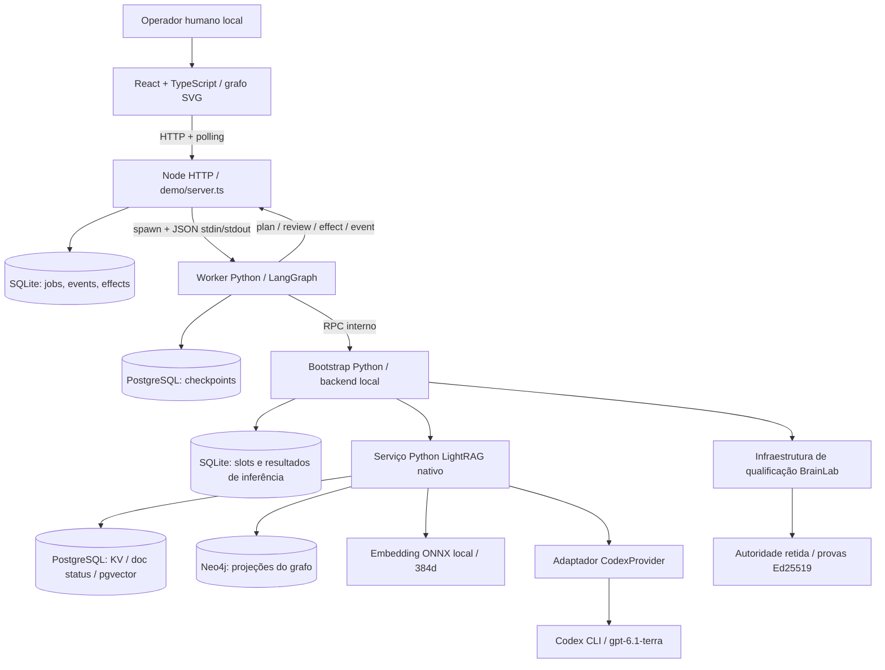

# Estado técnico da plataforma empresarial multiagente

**Data de referência:** 05/11/2026, America/Sao_Paulo. Captura técnica em `snapshot.json`, com timestamp UTC.  
**Workspace inspecionado:** `C:\Users\PC\multi-agent`.  
**Finalidade:** transferência para a conversa original do ChatGPT, especialmente para atualizar observabilidade, orquestração e critérios de evolução.  
**Método:** leitura do código atual, relatórios, JSONs, logs e JUnit existentes; consulta somente de leitura às duas aplicações locais e aos clones Git. Nenhum novo E2E, chamada LLM, implantação, aprovação ou efeito foi executado para produzir este documento.

## 1. Situação executiva e decisão vigente

Existe um **MVP demonstrável local**, com interface própria, API TypeScript, processos Python, LangGraph com checkpoints PostgreSQL, recuperação LightRAG nativa e chamadas reais ao modelo. Há duas entregas verticais: ACME/vendas-estoque e Aurora/diretorias-especialistas. Ambas continuam acessíveis na captura, sem workers ativos.

O produto empresarial completo ainda não foi consolidado. A aplicação depende da bancada, usa SQLite no domínio e executa cenários fechados com documentos fictícios. Não há dados de cliente, execução externa real ou capacidade empresarial homologada.

**Decisão técnica:** manter LangGraph e LightRAG e avançar somente em engenharia delimitada pelos defeitos demonstrados. Produção permanece **NO-GO**. O desenvolvimento das demos foi autorizado pelo usuário depois do gate negativo; essa autorização não converteu os bloqueios em PASS nem aprovou desenvolvimento amplo como se a robustez estivesse garantida.

Os bloqueios mais concretos são:

1. Três janelas de recuperação do `business_read_commit` da camada própria continuam reprovadas no gate V1.
2. Encerramento governado da categoria de inferência sem recibo continua reprovado no mesmo gate.
3. No Aurora, a campanha multidepartamental foi rejeitada por falta de reconciliação documental. O incidente passou no recorte delimitado; o resultado global do ensaio é **FAIL**.
4. Persistência empresarial PostgreSQL, identidade para acesso real, gateway/sandbox geral, conectores, custo monetário atribuível e DR externo ainda não foram entregues/homologados.

Não foi demonstrada impossibilidade universal de construir a solução com essa stack. Os negativos identificam contratos e integração próprios que ainda precisam funcionar corretamente.

## 2. Paperclip: descarte e correção do histórico

**Paperclip não participa do fluxo ativo das demos.** Não agenda trabalhos, não mantém a organização operacional, não concede aprovação e não recebe callbacks de conclusão. Nossa API, nossa política e LangGraph assumiram essas responsabilidades no recorte implementado.

É incorreto transferir para a outra conversa a afirmação de que a impossibilidade de integrar Paperclip sem fork foi provada. `validation/paperclip-recheck/REPORT.md` registra explicitamente o contrário: a composição por adaptador externo funcionou sem alteração rastreada do core, inclusive após adaptar o recibo de cancelamento. O NO-GO era de homologação/adequação do recorte, não um teorema de impossibilidade. A decisão posterior foi seguir sem a plataforma para manter nossa própria camada e um owner de workflow.

**Dependência residual de desenvolvimento:** `demo/build.cjs`, o build Aurora e a configuração TypeScript ainda resolvem pacotes já instalados sob `vendor/paperclip/node_modules` e `vendor/paperclip/ui/node_modules`. São React, esbuild, TypeScript/tipos utilizados como ferramentas de build; isso não ativa o servidor Paperclip. Antes de distribuição autônoma, essas dependências precisam de manifestos/lock próprios e caminhos independentes da bancada.

Também não foram incorporados ao MVP ativo OpenCompany, OpenAgents, Eigent, AgentScope, Graphiti, Dify/Graphon, Onyx, Glean ou ServiceNow. Há pesquisas, clones e testes históricos desses candidatos. Não confundir presença no disco ou prova isolada com integração atual.

## 3. Arquitetura efetivamente executável



Esse diagrama descreve o arranjo local; não exige um microserviço por caixa no produto. Há processos auxiliares de bancada e containers de dados. A infraestrutura herdada também inicia componentes empresariais/editoriais da qualificação; **o ledger da interface é `journey.sqlite`**, e não deve ser confundido com o protocolo empresarial mais amplo de `validation/langgraph-business-flow/business.ts`.

### Fronteiras de responsabilidade

| Camada | O que implementa hoje | Limite importante |
| --- | --- | --- |
| UI própria | Pedidos delimitados, etapas, equipe, fontes, parecer, aprovação/rejeição, retomada e consumo | Não há editor/importador corporativo geral nem autenticação humana empresarial |
| API Node/TypeScript | Política, plano, aprovação exata, estado, eventos, disparo de worker e efeito local idempotente | Ledger SQLite local; não é um servidor empresarial completo |
| LangGraph/Python | Avanço do grafo, fan-out/fan-in, subgrafos Aurora, pausa humana e retomada | A4 completo, cancelamento durável geral e recuperação empresarial não concluídos |
| Backend Python da demo | Bootstrap, estado de motores, retrieval permitido e slots de inferência | Parte da infraestrutura de desenvolvimento, dependente de helpers de testes |
| LightRAG | Chunking, extração nativa, projeções, recuperação vetorial/grafo | Recuperação não garante cobertura completa da fonte nem verdade de toda síntese |
| Camada de políticas | Catálogo permitido, seleção válida, fontes atuais, gabarito estruturado, hash/payload | Regras fechadas não são um verificador universal de fatos ou ACL corporativa completa |
| Autoridade de bancada | Reservas/provas/atualidade em ensaios e infraestrutura reutilizada | Não agenda o workflow; não é um serviço operacional externo recuperável já contratado |

**LangGraph é o único owner de workflow.** A API aplica contratos e inicia/retoma processos. A autoridade de provas, o backend de inferência e o banco não se tornam coordenadores concorrentes. Não há Temporal, Kafka ou Redis incorporados às demos.

## 4. Estrutura real do workspace

```text
C:\Users\PC\multi-agent\
├─ README.md
├─ docs/
│  ├─ ARQUITETURA_BASE.md          # desenho-alvo e requisitos R01–R21
│  ├─ PLANO_DESENVOLVIMENTO.md     # marcos M1–M3, não conclusão desses marcos
│  ├─ PENDENCIAS_PRODUCAO.md       # backlog e gates
│  ├─ REVISAO_NO_GO.md
│  ├─ ENCERRAMENTO_INVESTIGACAO.md
│  └─ BASELINE.json               # registro histórico, não snapshot atual
├─ demo/                          # entrega ACME / vendas e estoque
│  ├─ server.ts, policy.ts, worker.py, start.py
│  ├─ ui.tsx, ui.css, index.html, build.cjs, tsconfig.json
│  ├─ Start-Demo.ps1, Stop-Demo.ps1
│  ├─ test_journey.py, policy.test.ts, server.test.ts
│  ├─ README.md, RESULTS.md, COMMANDS.md
│  ├─ evidence/                   # exportações e hashes
│  └─ .state/                     # privado: sessão, bancos, tokens e logs
├─ demo-enterprise/               # entrega Aurora
│  ├─ corpus.json, catalog.json, policy.ts
│  ├─ worker.py, start.py          # reutiliza demo/server.ts
│  ├─ ui.tsx, ui.css, build.cjs, tsconfig.json
│  ├─ Start-Aurora.ps1, Stop-Aurora.ps1
│  ├─ test_scenarios.py, policy.test.ts, test_embedding_pooling.py
│  ├─ README.md, RESULTS.md, COMMANDS.md, record.py
│  ├─ evidence/                   # resultados positivos e negativos
│  └─ .state/                     # privado
├─ validation/                    # bancadas, ambientes, JUnit, manifests
│  ├─ STATUS.md
│  ├─ integrated-pilot/           # ambiente Python e provider de referência
│  ├─ temporal-editorial/, canonical-decisions/
│  ├─ concurrent-reconciliation/, restore-concurrent-state/
│  ├─ langgraph-business-flow/, langgraph-retained-flow/
│  ├─ governed-recovery/, brain-recovery/, detached-inference/
│  ├─ investment-gate/            # V1–V4; quatro critérios vermelhos
│  └─ ...                         # comparações e demais ensaios históricos
├─ research/                      # fontes, snapshots e estudos comparativos
├─ poc/                           # dossiê e auditoria/PoC inicial Paperclip
├─ vendor/                        # clones inspecionados, não distribuição
└─ reports/estado-tecnico-2026-11-05/  # este relatório e captura de transferência
```

Há também ZIPs históricos na raiz e caches/ambientes de desenvolvimento. Não devem ser usados como distribuição do produto. Não existe nesta raiz um monorepo próprio já organizado em `apps/`/`packages/`, CI/CD próprio comprovado ou um checkout Git raiz com histórico das nossas mudanças.

## 5. Tecnologias e versões rastreáveis

| Componente | Referência observada |
| --- | --- |
| Node.js | 24.20.0 |
| Python principal de validação | 3.12.14 |
| TypeScript | 7.0.2 no pacote local utilizado |
| React / React DOM | Perfil React 19.2.8; pacotes resolvidos no ambiente já instalado |
| esbuild | 0.28.2 |
| LangGraph | 1.2.19; SHA na seção de commits |
| langgraph-checkpoint | 4.3.1 |
| langgraph-checkpoint-postgres | 3.2.0 |
| psycopg | 3.3.7 |
| LightRAG | lightrag-hku 1.5.8; fonte fixada no clone |
| asyncpg / driver Neo4j | 0.32.0 / 6.4.1 no ambiente registrado |
| cryptography | 50.0.2 no ambiente registrado |
| pytest | 9.2.0 na sessão Aurora |
| Banco do domínio das demos | SQLite via `node:sqlite`, WAL; SQLite também nos adaptadores Python |
| Checkpoints | PostgreSQL real com AsyncPostgresSaver |
| Conhecimento | PostgreSQL + pgvector + Neo4j reais |
| Embedding | MiniLM multilíngue, ONNX local, 384 dimensões |
| Modelo nas demos | `gpt-6.1-terra`, chamado pelo adaptador Codex CLI |
| UI de rede | SVG interativo; não Three.js/3D nesta versão |

Imagem PostgreSQL/pgvector fixada:

```text
pgvector/pgvector@sha256:c0cd736fe8b8b5d408db56b780570bac404fe518e66e39de624aa46f9aabc60a
```

Imagem Neo4j fixada:

```text
neo4j@sha256:fe8607113c4177fbd2466bf2c30f1ebab5b9530594e86487c58c98e113145192
```

Embedding: `sentence-transformers/paraphrase-multilingual-MiniLM-L12-v2`, artefatos ONNX de `Qdrant/paraphrase-multilingual-MiniLM-L12-v2-onnx-Q`, revisão `faf4aa4225822f3bc6376869cb1164e8e3feedd0`. Pesos locais são conferidos por SHA-256; o serviço opera sem baixar modelo ou executar código remoto. O runtime de embeddings possui ambiente próprio.

As versões fixadas descrevem o que foi ensaiado. Não são alegação de latest nem aprovação de atualização automática. A captura Aurora registra apenas parte dos pacotes; o ambiente histórico de `validation/detached-inference/environment.json` complementa drivers/imagens. Não existe ainda lock autônomo completo da aplicação comercial.

## 6. Serviços e endpoints atuais

### Aplicações acessíveis na captura

| Aplicação | URL local | Estado observado |
| --- | --- | --- |
| ACME | `http://127.0.0.1:59587` | Motores ready; dois trabalhos completed, com recibos simulados |
| Aurora | `http://127.0.0.1:58678` | Motores ready; campanha failed e incidente awaiting_approval |

Portas são efêmeras de cada sessão. Não representam endereços de implantação. A captura não reiniciou nada; `ready` informa prontidão dos motores e não transforma trabalhos falhos em sucesso.

### API HTTP compartilhada — `demo/server.ts`

| Método e caminho | Contrato implementado |
| --- | --- |
| `GET /` | HTML da UI do perfil |
| `GET /app.js` | Bundle JavaScript |
| `GET /app.css` | CSS |
| `GET /api/state` | Prontidão, fontes/uso e lista de trabalhos com plano, revisão, aprovação, recibo e eventos; Aurora acrescenta catálogo/cenários |
| `POST /api/jobs` | Admite cenário permitido, inicia worker e retorna `{id}` com HTTP 201; não significa conclusão |
| `POST /api/jobs/{id}/approve` | Exige revisão pendente e hash exato; persiste aprovação e inicia retomada |
| `POST /api/jobs/{id}/reject` | Rejeita revisão pendente com hash correspondente; impede retomada posterior do rejeitado |
| `POST /api/jobs/{id}/resume` | Novo worker retoma pelo checkpoint/estado; não concede aprovação |
| `POST /internal/snapshot` | Estado do trabalho para o worker |
| `POST /internal/event` | Persiste evento do worker |
| `POST /internal/plan` | Valida e vincula plano |
| `POST /internal/review` | Valida relatório e vincula hash/payload da proposta |
| `POST /internal/effect` | Confere aprovação e grava/reutiliza recibo local simulado |

As rotas internas exigem `x-demo-token`; esse token não é uma identidade empresarial por usuário. API em loopback, checagem de Host/Origin, JSON obrigatório em POST, limite de aproximadamente 20 mil caracteres no corpo, cabeçalhos CSP/no-store/nosniff. Rotas desconhecidas recebem 404; conflitos/recusas normalmente 409; falta de token interno 403. Não se deve inferir um contrato REST empresarial completo desses códigos.

`approve` aceita também a opção de teste `crash_after_effect=true`: provoca saída controlada do worker depois do recibo. É fault injection de desenvolvimento, não função de produção.

**Não existem nessas demos:** `/health` ou `/ready` dedicados, endpoint público de busca arbitrária, upload/editorial completo, API de criação livre de agentes, streaming SSE/WebSocket, autenticação corporativa ou endpoint de cancelamento durável por trabalho. A UI usa `GET /api/state` por polling; no Aurora, a cada 1.300 ms. Não inventar essas interfaces na proposta de integração.

### Serviços internos da infraestrutura

| Serviço | Transporte | Operações relevantes |
| --- | --- | --- |
| Backend `start.py` | HTTP local `POST /rpc`, token interno, porta dinâmica | `status`, `worker_config`, `retrieve`, `llm`, `stop` |
| LightRAG nativo | aiohttp local `POST /rpc`, HMAC do corpo e timestamp | `stage`, `query`, `verify`, `inventory`, `freeze`, `open`, `shutdown`; perfis também permitem `evaluation` e inferência/lookup destacados |
| Embedding | HTTP local `POST /embed`, HMAC e timestamp | Vetores de lotes permitidos, métricas de segmentos/truncamento |
| Autoridade retida de bancada | HTTP local `POST /rpc`, segredo de transporte; provas Ed25519 | Reservas, operações, testemunhos/inventários conforme perfil |
| Checkpointer | SQL PostgreSQL | Snapshots, tasks e escritas pendentes do LangGraph |
| Grafo de conhecimento | Bolt Neo4j | Projeções de entidades/relações |

`worker_config` contém configuração privada e não deve ser encaminhado ao navegador ou anexado ao ChatGPT. `.state/active.json`, DSNs, tokens e prompts privados não fazem parte do pacote de transferência.

## 7. Orquestração implementada

### ACME

```text
START → chief_of_staff
      → Send(specialist: sales_analysis)
      → Send(specialist: inventory_analysis)
      → synthesis → approval/interrupt → effect → END
```

O Chief faz uma chamada real de planejamento; a política restringe a equipe às duas capacidades permitidas. Cada especialista recupera as fontes autorizadas do recorte e faz sua chamada. A síntese usa os retornos. São quatro slots por análise: planejamento, dois especialistas e síntese. A pergunta é fixa; isso não é um console geral.

### Aurora: hierarquia real em subgrafos

```text
START → Chief: seleciona times e justifica excluídos
      → Send(department, team) para cada diretoria selecionada
          subgrafo: START → Send(specialist) → director_review → END
      → synthesis do Chief → approval/interrupt → effect local → END
```

Catálogo de sete diretorias: Executiva, Marketing, Operações, Finanças, Pessoas, Jurídico e Tecnologia; cada uma possui dois especialistas. O Chief fica fora da contagem de 21 papéis disponíveis. Os títulos são exemplos configurados no fixture, não cargos obrigatórios de toda empresa.

A política exige de um a quatro times, um diretor e um ou dois especialistas próprios por time, no máximo oito agentes, sem repetição. Todos os não selecionados devem ter justificativa. A2 é um time; A3 são vários. A inferência recebe o catálogo completo, mas não o gabarito numérico. A cobertura esperada de áreas é verificada posteriormente pelo ensaio, não imposta como rota fixa no código.

`Send` faz fan-out de tarefas; reducers por adição reúnem os retornos. Diretores recebem seus especialistas e evidência própria. Subgrafos usam o checkpointer herdado. Isso não comprova execução distribuída em vários hosts: tudo foi exercitado no host local, e o adaptador de modelos ainda serializa chamadas. Não há ganho de latência paralelo demonstrado.

### Checkpoints e estado de negócio

`AsyncPostgresSaver`, `durability='sync'`, `thread_id` estável por trabalho (`demo:{job}` ou `aurora:{job}`). Cada execução/retomada inicia outro processo Python. `interrupt` pausa na aprovação; `Command(resume=...)` só é usado quando a API possui a aprovação correspondente.

Estados da aplicação incluem `created`, `running`, `awaiting_approval`, `completed`, `failed`, `interrupted` e `rejected`. Reinício do servidor marca trabalhos que estavam running como interrupted. A API limita a execução a um trabalho ativo por instância e possui índice parcial de admissão no SQLite. Não há uma fila empresarial com prioridades/fairness/backpressure já implementada.

O checkpoint é progresso computacional; `journey.sqlite` contém a decisão de negócio. São persistências distintas. Não há transação distribuída que cubra checkpoint, banco e qualquer API externa.

### Aprovação e efeito

O hash SHA-256 vincula trabalho, relatório e payload, incluindo operação, destinatário e conteúdo. O servidor recalcula essa vinculação e exige aprovação exata. O booleano `requires_approval` do modelo não concede autorização.

O efeito atual é uma linha local, com unicidade por trabalho e recibo persistido em transação SQLite. Repetição encontra o mesmo recibo. Essa propriedade foi testada inclusive com queda antes do checkpoint final. **Não é prova de exactly-once para email, ERP, pagamento ou outra API remota.**

## 8. Memória, conhecimento e integridade

É necessário distinguir quatro persistências:

| Categoria | Implementação | O que não significa |
| --- | --- | --- |
| Fonte canônica | Conteúdo original, versão, hash e metadados; contratos editoriais próprios na bancada | Não é uma inferência reescrita do original |
| Projeção de conhecimento | LightRAG, PGKV/PGDocStatus/pgvector, Neo4j e embeddings | Grafo recuperado não é autoridade automática de toda afirmação |
| Memória de execução | Checkpoints LangGraph/PostgreSQL e estado de tasks/subgrafos | Checkpoint não substitui autorização, recibo ou recuperação de negócio |
| Histórico de decisões | Plano, parecer, aprovação, resultado original, recibos e eventos em SQLite | Histórico não deve ser regenerado por LLM para “reconstituir” o que foi decidido |

Nas demos, o staging usa assinatura HMAC de **revisor de fixture**. Conteúdo/hash/versão são reais, mas não existe ainda a jornada de revisão humana empresarial na UI. A infraestrutura possui stores canônicos/editoriais e provas; o fato de estarem disponíveis não implica que todos os contratos de publicação, ACL e recuperação da bancada estejam integrados à aplicação.

LightRAG configura `PGKVStorage`, `PGVectorStorage`, `PGDocStatusStorage` e `Neo4JStorage`. As projeções do ensaio são separadas por documento/versão/workspace. Há um catálogo/cérebro lógico central, mas não foi comprovado um grafo empresarial único mesclado com todas as relações entre departamentos.

ACME usa contexto em modo `naive`. Aurora usa `mix` e palavras-chave fornecidas pelo adaptador para as consultas conhecidas. IDs, versões e hashes acompanham o contexto. As fontes permitidas são definidas no servidor pelo catálogo do agente selecionado. Isso não equivale a RLS/ACL empresarial de usuários e grupos reais; os documentos deste recorte são fictícios e acessíveis ao operador local.

No Aurora: chunks 512/overlap 32; embedding com agrupamento de segmentos locais e pooling ponderado/normalizado. O identificador `minilm-faf4aa4-pool512` separa esse espaço vetorial do perfil direto anterior. Registro final: 412 segmentos em 76 lotes, máximo enviado de 120 tokens WordPiece e zero entradas registradas como truncadas. Cobertura de tokens não garante retenção semântica, relevância ou presença de todas as provas na síntese.

O gabarito da política confere fatos estruturados, valores, tolerância numérica, fontes vigentes e bibliografia antes da aceitação. Não verifica universalmente a implicação de cada citação nem cada frase livre. O caso Aurora reprovado demonstra exatamente essa fronteira: o sistema bloqueou a entrega, mas ainda precisa recuperar/reconciliar melhor a evidência.

**Graphiti não é a memória operacional atual.** Nos ensaios históricos, Terra acertou 3/7 e Sol 6/7; a história anterior a correções não passou. Não adotar suas projeções como autoridade temporal exclusiva. **Obsidian é opcional:** há Markdown/Vault e contratos editoriais; o aplicativo não foi homologado pela UI, e não é dependência para executar a plataforma.

## 9. Integrações e segurança: implementado versus futuro

| Integração/controle | Estado efetivo |
| --- | --- |
| React → API própria → LangGraph | Funcional nas duas demos |
| LangGraph → LightRAG → ONNX/PG/Neo4j | Funcional no recorte nativo |
| Modelo | Codex CLI/Terra real, com slots e usage; sem conta API comercial testada na demo |
| Permissão de equipe/fonte e aprovação exata | Implementadas para os cenários delimitados |
| Slots de inferência | Gravados antes da chamada; resultado conhecido reutilizável com mesmo prompt; unknown bloqueia repetição automática |
| Auth humana | Operador local; Keycloak e OpenFGA adiados por decisão do usuário |
| Tokens internos/HMAC | Presentes; identidade de fixture e transporte loopback, sem TLS/mTLS empresarial |
| MCP/gateway universal | Planejado; nenhum conector produtivo geral homologado |
| ERP, CRM real, Drive, email, calendário etc. | Não integrados; o CRM do incidente é cenário documental fictício |
| Glean e ServiceNow | Pesquisa documental; sem instâncias/contratos de teste disponíveis |
| Sandbox geral de ferramentas/código | Não integrado/homologado no MVP |
| Login, segredos, DR, custo comercial | Pendentes para operação empresarial |

O subprocesso de inferência utiliza restrições do provider, sem tools/shell/rede de ferramentas autorizadas no ensaio. O serviço confiável recebe configuração de banco; o adaptador filtra o ambiente entregue à inferência. Não confundir essa restrição com sandbox universal contra código arbitrário ou com ausência de comunicação ao provedor de modelo.

Houve testes isolados reais de isolamento Docker e Dify Sandbox. No V4, um executor restrito passou controles básicos e timeout com processo filho. Na avaliação Dify, rede/arquivos/subprocessos tiveram recusas, mas espera/loop falharam por syscall proibida, sem validar timeout. Nenhum desses resultados homologa todo gateway do produto; o Dify Sandbox não está ativo nas demos.

Logs e eventos atuais podem conter texto dos documentos e saídas completas porque o corpus é fictício. Antes de dados reais, R16 exige redaction, classificação, controle de acesso e retenção. Um token global local e uma checagem de Origin não equivalem a login corporativo seguro.

## 10. Commits, histórico e integridade do código

**A raiz não é um repositório Git.** A captura de `git rev-parse --show-toplevel` retornou exit 128. Portanto não existem commits próprios verificáveis, branch, tag de release, PR ou histórico versionado da aplicação que possam ser listados com honestidade. Os SHAs abaixo são de componentes upstream inspecionados, não commits do nosso produto.

| Clone | HEAD observado | Papel atual |
| --- | --- | --- |
| LangGraph | `3c916d750575b22c464790e9774494d810ccd322` | Motor de workflow ativo |
| LightRAG | `aaebfe1bb8d55deb6a4304d357a3bf4c92fcd40a` | Motor de conhecimento ativo |
| Paperclip | `1e3ab690b072bbf6a1c1f1d0454ea49315b2074c` | Histórico/auditoria; dependências de build residuais |
| Graphiti | `7e0342a49ce5a04f6415ac2f64ce150bb81b0689` | Avaliação histórica |
| OpenCompany | `dc69aec7cfa70732de486512c1ba424bb855fd52` | Avaliação histórica |
| OpenAgents | `6a330c789c321bdce5856578b7c47c2539ea7fc6` | Avaliação histórica |
| Eigent | `4958c94bd91faf4e0bfff270a971d4d1810fb6db` | Avaliação histórica |
| AgentScope | `9668b4c90c70cc214e1b7bb65dec2a6e70b90010` | Avaliação histórica |

Na captura, `git status --porcelain --untracked-files=no` estava vazio nesses oito clones. Isso verifica alterações rastreadas, não ausência de arquivos não rastreados ou de dependências instaladas. Datas/mensagens dos commits estão em `snapshot.json`.

Como rastreabilidade provisória, existem manifestos SHA-256. O manifesto Aurora atual conferiu **25/25 arquivos**, sem ausências/divergências. O manifesto antigo ACME possui **uma divergência: `demo/server.ts`**, alterado posteriormente para suportar o perfil Aurora. Isso é evolução conhecida, não motivo para reescrever a evidência antiga. A regressão HTTP compartilhada passou, assim como strict/políticas, mas o E2E ACME original não foi executado novamente contra todo o código atual. Não transferir automaticamente o PASS antigo a qualquer modificação posterior.

`docs/BASELINE.json` é histórico e contém a fase de uma transição anterior. Não substitui o estado mais recente nem as condições posteriores de investimento. A outra conversa deve usar este relatório, os ensaios mais recentes e os requisitos, e não interpretar todo texto histórico como decisão simultaneamente vigente.

## 11. E2E e testes executados: evidências principais

Os números abaixo são execuções históricas, não uma nova suíte executada hoje. Checkpoints de aceite não são testes independentes. Há sobreposição entre regressões e tentativas; **não somar tudo como uma cobertura única**. Tempos podem ser internos ao teste ou do pytest/cleanup, conforme o relatório de origem. `snapshot.json` lista os JUnit de primeiro nível encontrados nas bancadas.

### MVP ACME — 05/11

**E2E PASS em 35,77 s, cinco checkpoints de aceite**, com LightRAG/ONNX/PG/Neo4j e Terra reais:

- Três fontes prontas, com versão/hash.
- Chief + vendas + estoque + síntese: receita 10.000 → 8.000, queda 20%, zero rupturas e causa não comprovada.
- Retomada antes de aprovação ficou pausada e não fez inferência adicional.
- Hash errado e efeito interno sem token foram recusados.
- Aprovação de teste; saída 88 após recibo local e antes do checkpoint final.
- Novo processo concluiu com o mesmo recibo; replay final manteve um efeito e zero nova inferência. Cinco processos distintos participaram do primeiro trabalho.

Evidências: `demo/evidence/journey.json`, `demo/RESULTS.md`. Quatro testes locais de política/API passaram e strict passou. Parte HTTP usa backend controlado, sem LLM; não atribuir qualidade semântica a esse teste.

O relatório original dizia que a segunda análise aguardava aprovação. **Estado posterior confirmado:** o usuário pediu aprovação; `demo/evidence/user-approval.json` registra a conclusão desse segundo trabalho com recibo `17e1c1d7-3817-4b58-bf8c-caeb8f9a0e37`, sem aumentar as 11 chamadas. A captura atual mostra os dois trabalhos completed e simulados.

### MVP Aurora — 05/11

Corpus: 16 documentos vigentes e uma versão histórica não indexada; 21 papéis disponíveis. Empresa fictícia com 18.400 colaboradores, sete países, quatro unidades e 12 centros de distribuição. **Esses números não são carga medida.** Os documentos são curtos, com dependências cruzadas; não são um corpus volumoso de contratos extensos.

| Fluxo | Seleção efetiva | Execução/inferência | Resultado |
| --- | --- | --- | --- |
| Campanha Horizonte/Orion | Marketing+campanhas; Operações+suprimentos; Finanças+controladoria; Jurídico+conformidade | 8 selecionados/8 concluídos/8 agentes com slots; 13 inativos; 10 chamadas de análise contando plan/synthesis | **FAIL** do parecer; sem aprovação/efeito |
| Incidente CRM INC-47 | Tecnologia+segurança; Jurídico+conformidade | 4 selecionados/4 concluídos/4 agentes com slots; 17 inativos; 6 chamadas incluindo plan/synthesis | **PASS delimitado**, awaiting_approval; sem efeito |

A correspondência selecionados = concluídos = slots foi exportada em `demo-enterprise/evidence/decisions.json` para os dois fluxos. Os excluídos não fizeram chamadas de inferência. A retomada do incidente em novo processo conservou a pausa e o contador de chamadas.

**Falha semântica:** briefing diz 5.000 pedidos; Comercial esclarece 5.000 unidades incrementais de campanha, diferentes das 6.000 unidades Orion. O gabarito exige 11.000 unidades combinadas e falta de 8.000 diante de 3.000 livres. O contexto/consolidação não preservou essa reconciliação; a síntese declarou total desconhecido. O servidor rejeitou `combined_demand_units`. Não se alterou o gabarito ou a saída para produzir PASS.

O candidato acertou estoque livre 3.000, margem 26,24% versus mínimo 28%, caixa livre R$130 mil, verba R$180 mil, lacuna R$50 mil, suprimento não confirmado e alegação ambiental sem prova. São acertos parciais; não aprovam o parecer completo.

**Incidente:** 1.200 contatos potencialmente envolvidos; exfiltração não confirmada; 25 minutos decorridos e 65 restantes de SLA interno fictício de 90 minutos. Nenhuma contenção, acesso ao CRM real ou comunicação externa foi feita.

**Falhas de preparação preservadas:** fragmentação excessiva por limite de embedding; identificador de tabela PostgreSQL longo demais após mudar nome do embedding; decodificação UTF-8 no stdin Python/Windows, corrigida com leitura explícita de bytes. A campanha foi retomada do checkpoint sem repetir agentes. A causa exata da perda documental entre retrieval e consolidações ainda não foi isolada.

Oito testes de política passaram; dois de segmentação/pooling passaram; regressão HTTP compartilhada de um teste passou; strict passou. A verificação integrada final retornou **código 1 e resultado global FAIL**. Evidências e comandos em `demo-enterprise/RESULTS.md`, `COMMANDS.md`, `scenarios-verified.log` e `evidence/`.

### Bancadas históricas relevantes ao desenho atual

| Rodada | Resultado registrado | Limite de transferência |
| --- | --- | --- |
| Comparação LangGraph/AgentScope | Ambos atenderam o contrato de teste; LangGraph escolhido por checkpoint/interrupt nativos | Não justifica dois owners de workflow |
| Qualificação de decisão | E2E 11 checkpoints, 258,40 s; modelo Terra 7/7 no lote; controles de identidade/quotas sintéticos | Extração/embedding ainda eram fixtures nesse recorte |
| Integração semântica nativa | E2E PASS, 8 checkpoints, 398,71 s | Quatro documentos por geração; não corpus empresarial |
| Canônico → LightRAG → decisão | E2E PASS, 214,39 s, cinco casos temporais | Recorte pequeno; histórico exato/ACL não equivalem a memória temporal universal |
| Avaliação ampliada | E2E PASS, 355,78 s; Terra mix/naive e Sol com prompts fixos, 4/4 cada | Não diferenciou qualidade geral; sem recibo continua bloqueado |
| Recuperação operacional conjunta | E2E PASS, 333,28 s, 10 Terra | Restore frio da fixture, não DR externo |
| Atualidade/proveniência | Cinco checkpoints operacionais passaram; E2E original FAIL_SEMANTIC 1/4 | Revisão offline do grader deu 4/4 e oito regressões; E2E não repetido |
| Conciliação/concorrência | E2E PASS, 205,23 s, oito checkpoints; 13 Terra | Replay editorial recebeu regressões sem repetir E2E completo |
| Restore com duas APIs | E2E PASS, 483,30 s, sete checkpoints | 9 CLI/10 reservas; uma reserva sem execução; não continuidade arbitrária sem logs |
| Carga/corpus | 12/12 respostas; p95 histórico 11,268 s original e 0,064 s experimental, N=8 por rajada | Roteiro principal falhou ao esperar 429 em intenção fechada; regressão posterior separou novo=429/fechado=409, sem repetir principal |
| Fluxo TS+LangGraph | E2E PASS/9 checkpoints; 24 admissões, 15 aceitas/9×429; 12 Node+strict | Sem modelos; efeitos de provedor sintético |
| Autoridade retida+fluxo | E2E PASS/10 checkpoints; 21,43 s pytest; 3 Python/16 Node+strict | Novo PG/volume; sem novo conhecimento semântico |
| Recuperação governada | E2E final PASS/39,56 s; 5 Python/16 Node+strict | Categorias existentes; não cobre automaticamente o novo read_commit |
| Cérebro+restore | E2E PASS/240,67 s; 9 Terra no PASS, 19 em três tentativas | Startup/trava negativos preservados; restore local em novos volumes |
| Inferência fora da trava | E2E controlado PASS/14,36 s; nativo+restore PASS/251,42 s, 9 Terra | Novo read_commit e unknown ainda precisavam qualificação posterior |
| Reuso LangGraph nativo | PASS/10,92 s; tasks, retry, interrupt, pending writes e idempotência | Zero LLM; não requalifica o ledger empresarial |

Referências desses números estão nos `RESULTS.md`/`REPORT.md` das pastas correspondentes e em `validation/STATUS.md`. Resultados de startup, graders e scripts são mantidos como negativos quando aplicável; não se chama um probe que reproduz um defeito de PASS do requisito.

## 12. Gate V1–V4: negativos que continuam abertos

Fonte principal: `validation/investment-gate/RESULTS.md` e JUnit do diretório.

| Critério | Resultado | Significado |
| --- | --- | --- |
| V1: queda após intenção, antes do commit empresarial, saída 77 | FAIL | Recibo de inferência existe, mas categoria de recuperação não é conciliada; instalação permanece bloqueada |
| V1: após commit empresarial, antes do recibo local, saída 82 | FAIL | Leitura existe, diário incompleto; restore não inventa a conciliação |
| V1: após recibo local, antes da confirmação na autoridade, saída 83 | FAIL | Autoridade ainda pendente; recibo local não é aceito cegamente |
| V1: inferência admitida sem recibo | FAIL | Unknown bloqueado, sem procedimento elegível de encerramento para essa categoria |
| V1: heartbeat automático opcional | PASS delimitado | Renovação sustentou consulta longa; fencing impediu persistência tardia |
| V2: conhecimento | PASS pequeno | Oito releases, quatro casos semânticos, 48 contextos e mil vetores em ensaio separado |
| V3: equipe/controlador | Condicional; contrato final FAIL | Fatos corretos, mas modelo marcou aprovação falsa; backend manteve pausa |
| V4: operação/economia | Condicional/pendente | Controles locais; sem DR físico externo, IdP real ou fatura atribuível |

JUnit V1: três falhas e um PASS em 41,69 s; unknown: uma falha em 5,94 s. Zero LLM nesses testes de recuperação. O sistema não duplicou a inferência/efeito e não liberou resultado por bypass, mas **bloqueio seguro permanente falha o requisito de continuidade operacional**.

A fronteira de recuperação existente qualifica `business_create` e `business_effect`; não basta assumir que cobre `business_read_commit`. Checkpoint LangGraph, retries e restore do PostgreSQL não definem a regra de conciliação do nosso protocolo.

No V3, o caminho único acertou seis critérios em 6,19 s/uma chamada; a equipe chegou a cinco de seis em 44,74 s/cinco chamadas. N=1 e caminhos com overhead diferente: não prova superioridade geral, mas não mostrou ganho que justificasse convocar equipe para toda tarefa. O controlador adaptativo precisa justificar o escalonamento.

## 13. Carga, concorrência e custo: o que foi medido

Na sessão ACME: **11 chamadas**, 137.888 tokens de entrada, 50.048 em cache reportado e 2.248 de saída. Teto de 16 reservas. Aprovar/retomar os dois trabalhos não acrescentou inferência.

Na sessão Aurora funcional de motores: **32 chamadas**, sendo 16 de ingestão, dez da campanha e seis do incidente; 471.017 tokens de entrada, 314.112 em cache reportado e 33.723 de saída. Primeira tentativa adicional: 23 reservas, 22 chamadas concluídas e uma desconhecida. Segunda tentativa: zero modelo. Total Aurora entre tentativas: **55 reservas de 64**, incluindo a desconhecida; teto da sessão corrente é 41 após descontar as 23 anteriores.

Esses recortes não são um total global de toda a investigação. Há contabilidade histórica por rodada; somar arquivos de regressões repetidas ou snapshots pode duplicar chamadas. Cache é subconjunto da entrada e não deve ser somado novamente. Reserva sem usage não significa custo zero.

No V2, recuperação aquecida de contexto: concorrência 1/4/8 com N=16 por grupo e p95 de 0,181/0,405/0,763 s. Não são respostas LLM concorrentes. Mil textos transformados em vetores e 32 consultas de identidade passaram em outro ensaio de storage, p95 0,076 s; não foi ingestão semântica LightRAG de mil documentos.

**Não há custo monetário observado por fatura de API nem custo total de uma instalação.** Contagens vêm do Codex CLI, incluindo overhead próprio. Estimativas históricas por tabela de preços eram hipóteses daquele momento; este relatório não as atualiza nem as apresenta como gasto. Região, hardware, armazenamento, ferramentas, suporte e tributos não foram dimensionados. Não existe atualmente garantia de throughput empresarial ou SLO contratado.

## 14. Observabilidade efetivamente implementada

### Sinais existentes

- `events(seq, at, node, detail)` por trabalho em `journey.sqlite`; plano, começo/fim de especialista/diretor, síntese, consulta/salvamento de checkpoint, início/fim de processo, aprovação e recibo.
- Estado persistido, código de saída do worker e PID de execução; retomadas visíveis como processos distintos.
- Resultados e plano ligados ao trabalho; fontes/versões/hashes; candidato rejeitado exportado separadamente, sem apresentá-lo como revisão aceita.
- `model-slots.sqlite`: slot, hash de prompt, status unknown/completed e saída conhecida.
- `model-calls.jsonl`: modelo, duração, exit code, usage e eventos inesperados de ferramenta nos exports permitidos.
- `embedding-calls.jsonl`: tamanho do lote, segmentos, dimensão, tokens, truncamento, duração e hashes de entrada.
- Provas assinadas, inventários/manifests e JUnit nas bancadas; logs de bootstrap e falhas locais.
- UI com timeline, equipe/nós, fontes, estado de revisão e consumo, atualizada por polling.

Isso constitui rastreabilidade local útil, não uma implantação completa de observabilidade. Não há instrumentação própria integrada com OpenTelemetry, Langfuse, Prometheus/Grafana, collector externo, alertas ou armazenamento de traces distribuídos comprovados. `LANGSMITH_TRACING` e `LANGCHAIN_TRACING_V2` são desativados no spawn do worker. Bibliotecas instaladas ou recursos upstream não contam como serviço de telemetria adotado.

### Lacunas observadas

1. Não existe trace causal único cobrindo UI → API → worker → subgrafo → retrieval → embedding/LLM → aprovação/efeito.
2. O contador de chamadas/tempo não informa sozinho a qualidade da entrega nem localiza a perda de uma prova entre contexto e síntese.
3. Erros da API são frequentemente 409 genéricos; a causa detalhada fica em log privado. O parecer rejeitado não é mostrado como resultado aceito, mas a explicação operacional pode melhorar.
4. Não há medição empresarial de filas, saturation, p50/p95 por etapa/modelo, orçamento monetário reservado/consumido, loops, retrabalho ou intervenções humanas.
5. Os eventos têm detalhes heterogêneos e, no fixture, conteúdo completo. Não há pipeline de redaction/retention para dados confidenciais homologado.
6. Não há reconciliação automática e verificada de todos os estados entre API, checkpointer, provider e autoridade após cada tipo de falha.

## 15. Contrato sugerido para atualizar observabilidade e orquestração

**Esta seção é proposta, não código já entregue.** A outra conversa pode usá-la como entrada de projeto sem substituir os contratos e gates por um desenho apenas visual.

### Correlação mínima por operação

```text
installation_id, job_id, workflow_thread_id, checkpoint_id,
graph_node, task_id, parent_task_id, agent_capability,
plan_hash, policy_version, approval_hash,
source_id, source_version, content_sha, projection_id,
model_slot, provider_request_id, inference_receipt_id,
effect_intent_id, effect_receipt_id, lease_epoch,
trace_id, span_id, parent_span_id, event_id, occurred_at, recorded_at
```

Os campos devem existir conforme a operação, sem inventar IDs de provider que não foram retornados. Registrar ausência/unknown explicitamente. IDs de instalação não autorizam acesso por si mesmos.

### Eventos e spans a ligar

```text
job.admitted → plan.proposed → plan.validated
→ retrieval.started/completed/rejected
→ inference.reserved/started/completed/unknown
→ specialist.completed → director.completed
→ synthesis.proposed → review.accepted/rejected
→ approval.requested/approved/rejected
→ effect.intent/receipt/reconciled
→ checkpoint.saved → job.completed/blocked/failed
```

Uma integração de tracing deve acompanhar esse modelo sem virar outro scheduler. LangGraph continua dono do avanço; a API continua autoridade da política/aprovação; os recibos permanecem evidência de efeito. Um span finalizado não prova sucesso de negócio.

### Integridade do conhecimento: prioridade motivada pelo Aurora

Registrar os IDs e hashes dos trechos efetivamente recuperados e consumidos, sua fonte/versão, unidades, cobertura por fato obrigatório e a etapa em que foram descartados/resumidos. Conferir o texto canônico associado quando uma referência ou conflito exigir leitura adicional. A consulta não pode encerrar em “não informado” sem verificar se o fato está em uma fonte atual referenciada e autorizada.

Separar as avaliações: retrieval encontrou o trecho? especialista o usou? diretor preservou a unidade/condição? síntese reconciliou? política validou? A prova atual não permite atribuir toda a falha ao LightRAG ou ao LLM isoladamente.

### Métricas de aceite

Sucesso correto e autorizado por entrega; taxa de abstenção adequada; fatos sem suporte; cobertura de fonte e conflitos resolvidos; revisão humana/retrabalho; tempo/custo por etapa e por trabalho; agentes disponíveis/selecionados/executados; chamadas evitadas por replay; reservas unknown; idade de bloqueios; recuperação por janela; duplicações e efeitos indevidos; head/inventário divergente; motivos de seleção A0–A4.

Manter duas visões: (a) saúde técnica do serviço e (b) conclusão segura/correta do trabalho. Um incidente bloqueado por falta de recibo pode ser seguro e ainda falhar o SLO de continuidade.

### Dados e visualização

Telemetria deve ser isolada por instalação e preferir IDs, hashes, medidas e erros classificados. Conteúdo sensível só em repositório controlado com política explícita; não enviar prompts/documentos automaticamente a terceiros. A escolha do backend de observabilidade ainda deve ser feita, sem apresentar fornecedor candidato como instalado.

O grafo visual pretendido reúne cérebro/fontes, Chief, diretorias, especialistas e ferramentas. Deve derivar de eventos/estado: disponível, selecionado, executando, bloqueado, aguardando humano, concluído ou falho. Linhas ativas mostram delegações/dependências reais. As duas fotos fornecidas pelo usuário fixam direção visual; não provam a arquitetura do sistema retratado. O MVP atual tem SVG 2D, não a experiência 3D/JARVIS completa.

## 16. Funcional no MVP e ainda planejado

| Capacidade | Estado |
| --- | --- |
| Interface própria operável e fontes clicáveis | Funcional nos dois perfis |
| Chief real e especialistas | Funcional em tarefas delimitadas |
| Seleção de parte do catálogo e justificativas | Funcional no Aurora; não criação livre de equipes/agentes |
| Diretorias com subgrafos e consolidação | Funcional no Aurora |
| Checkpoint/interrupt/resume em outro processo | Funcional e testado no recorte |
| Aprovação por payload/hash e recibo simulado único | Funcional; E2E com queda testado no ACME |
| LightRAG nativo + embeddings + PG/Neo4j | Funcional, com falha de reconciliação ainda aberta |
| Tokens/chamadas e orçamento por slots | Funcional no recorte; dinheiro real pendente |
| Estado/logs/timeline e visualização central | Funcional em 2D/polling |
| Upload/revisão/publicação pela UI | Planejado; existem contratos/testes editoriais de bancada |
| PostgreSQL para todo domínio/migrations | Planejado; checkpointer/knowledge já usam PG |
| Controlador A0–A4 completo e catálogo empresarial dinâmico | Planejado; A2/A3 delimitados não equivalem a A4 |
| Login corporativo/ACL por usuário | Adiado pelo usuário; necessário para dados/acesso reais |
| Agentes permanentes aprovados e temporários governados | Desenho preservado, sem ciclo de vida geral entregue |
| Gateway MCP/APIs e conectores produtivos | Planejado |
| Cancelamento durável e recuperação de todos os efeitos | Pendente |
| Encerramento unknown/read_commit | Bloqueios de qualificação concretos |
| Sandbox geral e credenciais por operação | Pendente |
| DR externo, PITR/HA, upgrade/rollback | Pendente |
| Observabilidade distribuída e alertas | Planejado |
| JARVIS/3D conforme referências visuais | Planejado; base de estado existe |
| Provedor comercial/custo faturável/distribuição | Pendente |

## 17. Requisitos arquiteturais preservados

| ID | Requisito que a outra conversa deve manter |
| --- | --- |
| R01 | Instalação dedicada por empresa, isolando dados, execução, segredos, políticas e orçamento |
| R02 | Cérebro lógico empresarial central persistente; domínios configuráveis |
| R03 | Recuperação híbrida/grafo, relações, citações e proveniência |
| R04 | Fonte canônica revisada/versionada; vigência/publicação; histórias de fontes, fatos e decisões distintas |
| R05 | Permissões no servidor e em cada fronteira; histórico sujeito à autorização atual |
| R06 | Gestor → Chief de planejamento, síntese, comunicação e acompanhamento |
| R07 | Controlador A0–A4, começa simples e escala por dependência, risco, incerteza e orçamento |
| R08 | Equipes por capacidades configuráveis; cargos das demos não são schema obrigatório |
| R09 | Assessoramento e execução delimitada com revisão humana conforme risco |
| R10 | LangGraph como owner único; estado honesto, checkpoints, cancelamento e recuperação |
| R11 | MCP/APIs autorizadas, sandbox, menor privilégio e segredos fora de código não confiável |
| R12 | Intenção/efeito idempotentes, recibos, fencing/leases/heartbeat e unknown sem sucesso presumido |
| R13 | Orçamento por trabalho/equipe incluindo ingestão, retries, falhas e conciliação |
| R14 | Backup/restore inclui fontes, ACL, índices, diário e chaves; sem reautorizar estado antigo |
| R15 | Observabilidade da decisão, qualidade, segurança, latência, custo, loops e intervenções |
| R16 | Telemetria isolada, sem vazamento de segredos/PII/conteúdo confidencial |
| R17 | Centro de comando JARVIS/3D funcional, vivo, navegável e ligado ao backend |
| R18 | Reaproveitar motores; TypeScript empresarial + Python IA; não reconstruir bibliotecas inteiras |
| R19 | Obsidian/Markdown opcional; API própria independente do aplicativo |
| R20 | Dimensionamento-alvo de empresa grande; testes começam menores e crescem com medidas |
| R21 | Licenças/ativos/dependências e provedor comercial sem conta pessoal obrigatória do cliente |

Preservar requisitos não significa declarar todos implementados. A simplificação do login neste estágio foi decisão do usuário, não remoção definitiva de R05/R11/R16.

## 18. Próximos passos técnicos com critérios verificáveis

1. **Recuperação:** implementar conciliação da categoria read_commit nas três janelas e encerramento governado de inferência sem recibo; repetir os casos V1 contra o código do produto, sem duplicação, perda de resultado, bypass ou bloqueio permanente indevido.
2. **Conhecimento Aurora:** instrumentar cobertura de trechos, resolver referências/unidades entre fontes atuais e verificar texto canônico; repetir a campanha original, preservando o gabarito e o resultado negativo anterior.
3. **Política e resposta:** derivar exigência de aprovação da política autoritativa; tornar erro de contrato/parecer rejeitado explicável ao usuário sem vazar logs privados. Não depender do booleano do modelo.
4. **Base reproduzível:** criar repositório próprio e commits revisáveis, locks próprios, estrutura/configuração independente de vendor/Paperclip, migrations e bootstrap da aplicação; manter manifests históricos intactos.
5. **Observabilidade:** integrar correlação por trabalho/etapa e sinais de recuperação/qualidade antes de adicionar só efeitos visuais. Qualificar redaction/isolamento antes de conteúdo real.
6. **Piloto empresarial:** somente depois qualificar identidade, conectores autorizados, sandbox, medição monetária, carga representativa e DR externo no escopo contratado. A plataforma completa não recebe GO por passar novamente o exemplo pequeno.

Não há data ou percentual honesto de conclusão de produção com as medições atuais. A decisão deve ser por critérios atendidos na versão e ambiente que serão usados.

## 19. Operação e reprodução do recorte

Com os ambientes/dependências já existentes e Docker Desktop disponível, a partir da raiz:

```powershell
.\demo\Start-Demo.ps1
.\demo-enterprise\Start-Aurora.ps1
```

Na captura ambos já estavam prontos. Não iniciar outra instalação apenas para ler o relatório. Os launchers gravam o endereço em logs locais e preservam estado privado. Encerrar com os scripts `Stop-Demo.ps1`/`Stop-Aurora.ps1` remove somente recursos Docker da instalação verificados pelo rótulo de ownership; não equivale a backup/restore. Novo start cria outra instalação e não restaura automaticamente o PostgreSQL descartável da sessão antiga.

Comandos de verificação existentes, que não foram repetidos para elaborar este documento:

```powershell
node --test demo/policy.test.ts demo/server.test.ts
node --test demo-enterprise/policy.test.ts demo/policy.test.ts
node vendor/paperclip/node_modules/typescript/bin/tsc -p demo-enterprise/tsconfig.json
& validation/integrated-pilot/.venv/Scripts/python.exe -m pytest demo-enterprise/test_embedding_pooling.py -q
```

`demo/test_journey.py` e `demo-enterprise/test_scenarios.py` executam fluxos reais e podem consumir modelo; não são comandos de leitura. Os identificadores de trabalhos e os parâmetros de adoção usados na última verificação Aurora constam de `COMMANDS.md`. Não executar nova rodada inadvertidamente para “confirmar” a documentação.

## 20. Fontes locais e instruções para a conversa de destino

Ler como evidência primária:

- `demo/server.ts`, `demo/start.py`, `demo/worker.py`, `demo/policy.ts`.
- `demo-enterprise/start.py`, `worker.py`, `policy.ts`, `catalog.json`, `corpus.json`.
- `validation/brain-recovery/native.py`, `test_brain.py`; `validation/concurrent-reconciliation/embedding_server.py`, `embedding_pooling.py`, `codex_provider.py`.
- `demo/RESULTS.md`, `evidence/journey.json`, `evidence/user-approval.json`.
- `demo-enterprise/RESULTS.md`, `COMMANDS.md`, `evidence/scenarios.json`, `evidence/decisions.json`, `evidence/session.json`, `scenarios-verified.log`.
- `validation/investment-gate/RESULTS.md`, `v1.xml`, `unknown.xml`, `v23.xml`.
- `validation/brain-recovery/RESULTS.md`, `validation/detached-inference/RESULTS.md`, `environment.json` e `verification.json`.
- `validation/STATUS.md`, `docs/ARQUITETURA_BASE.md`, `PENDENCIAS_PRODUCAO.md` e `PLANO_DESENVOLVIMENTO.md`.
- `validation/paperclip-recheck/REPORT.md` para evitar repetir a falsa impossibilidade técnica.
- `snapshot.json` deste pacote: Git, versões, prontidão atual, trabalhos, integridade de manifestos e inventário de JUnit.

O relatório é autossuficiente para atualizar a proposta; os caminhos são relativos ao workspace original. O ZIP de transferência inclui uma seleção explícita de evidências textuais e este snapshot, sem `.state`, credenciais, DSNs, modelos, dumps ou node_modules. Não é um backup executável.

**Orientação à conversa original:** atualizar o desenho em torno do código existente; manter a separação entre owner LangGraph, política empresarial TypeScript, conhecimento LightRAG e autoridade/recibos. Não apresentar A4, conectores, telemetria distribuída, memória temporal universal, PostgreSQL empresarial completo ou produção como entregues. Tratar as fotos como referência de experiência visual e os testes como evidência operacional. Priorizar as quatro falhas de recuperação e a reconciliação documental demonstrada no Aurora.
