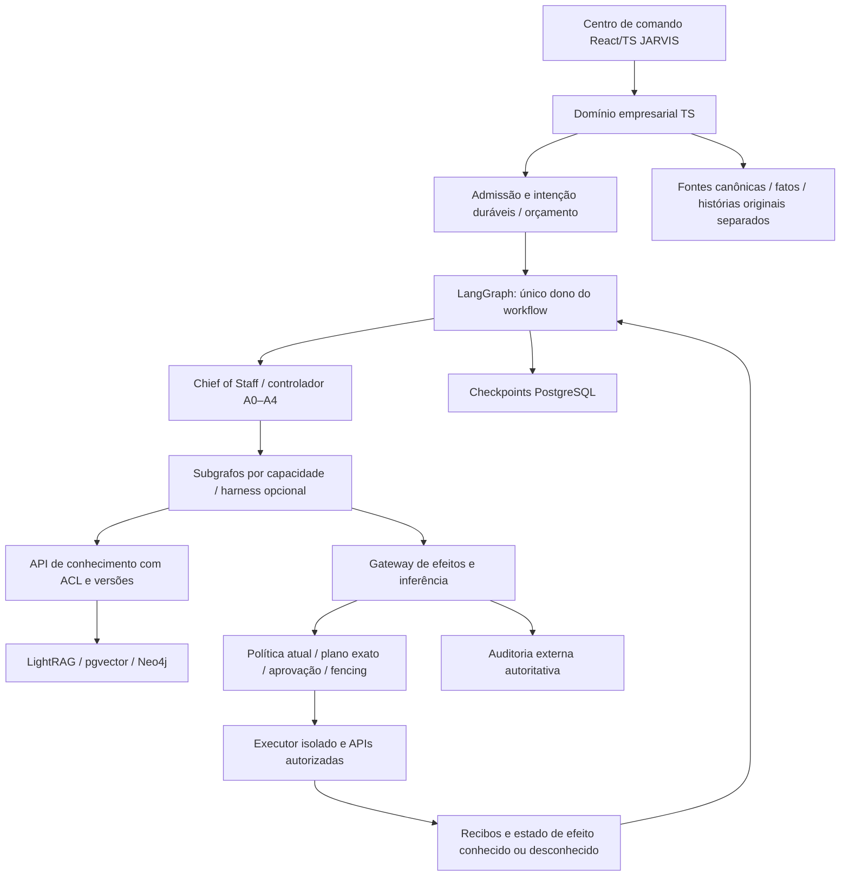

# Estudo comparativo: LangGraph e composição empresarial

Complemento posterior solicitado pelo usuário: [sistemas reais e conferências recentes](../production-conferences-2026-11-05/REPORT.md), com casos Uber/Stripe/Anthropic e trabalhos de durabilidade, coordenação, avaliação, segurança e conhecimento. Nenhuma adoção ou requalificação empresarial decorre apenas da ampliação documental.

Data: 05/11/2026. Decisão proposta para discussão; nenhuma aplicação ou harness novo foi instalado. Inspeção seletiva de seis repositórios, 44 arquivos capturados com commit/hash; leitura de células relevantes de nove notebooks, código, testes e documentação. Não foi uma auditoria integral desses repositórios. Inventários completos de caminhos não equivalem à leitura de todos os arquivos. Vídeos foram localizados pelo conteúdo indexado; não foram assistidos integralmente nem tiveram transcrição integral validada.

## Conclusão e mudança em relação ao estudo anterior

**Há fundamentos concretos para continuar qualificando LangGraph como motor. Não há fundamento para declarar impossível a arquitetura, nem para liberar nosso protótipo para produção.** O que existe pronto cobre execução com estado, composição, interrupções e retomada. Os contratos empresariais continuam exigindo implementação e testes próprios.

Recomendação: **LangGraph core como núcleo obrigatório; harness de agentes opcional e substituível em subgrafos delimitados.** Começar corrigindo a integração de recuperação existente com os mecanismos nativos já ensaiados. Avaliar Deep Agents separadamente para planejamento, delegação e gestão de contexto, sem torná-lo autoridade de permissões, conhecimento ou efeitos. Isso combina abordagens; não é criar outro motor do zero nem assumir um fork completo de aplicação.

O estudo anterior demonstrou quatro mecanismos nativos em uma fixture. Este estudo acrescenta comparação de cursos, aplicações e operação, contraexemplos de configuração/política e alternativas concretas de desenho. Não converte aquela fixture em homologação do ledger empresarial. Os **quatro FAIL de V1 permanecem abertos** em [RESULTS](../../validation/investment-gate/RESULTS.md).

## Fontes e o que elas sustentam

As versões abaixo são snapshots consultados nesta data, não dependências aprovadas. [Manifesto](manifest.json) relaciona cada arquivo a URL imutável e SHA-256. [Inventários](inventory) incluem licença declarada, estado archived e árvore retornada pela API. Todos retornaram `archived=false`. Isso não substitui avaliação de manutenção ou segurança.

| Categoria | Fonte e commit | Inspeção e resultado útil | Limite da evidência |
|---|---|---|---|
| Curso oficial introdutório | [LangChain Academy](https://github.com/langchain-ai/langchain-academy/tree/fa15bec4a51c541c40c261586b037c9d134977b1), `fa15bec4` | Persistência SQLite em disco; interrupção dinâmica; schemas de subgrafos; assistente de pesquisa; Store separado do checkpoint | Parte do ensino usa RAM e `NodeInterrupt`; migrar exemplos para contratos/API atuais. Não há prova de ACL empresarial por usar namespace |
| Curso oficial aplicado | [Deep Research from Scratch](https://github.com/langchain-ai/deep_research_from_scratch/tree/93f35e5d2a51590f9542207a9ff66a01901da5bc), `93f35e5d` | Supervisor, pesquisadores paralelos, compressão e agregação | O limite de paralelismo é instrução no trecho lido, não semáforo; exceção genérica encerra grafo; não copiar como tratamento de falha do produto |
| Aulas independentes | [CampusX](https://github.com/campusx-official/langgraph-tutorials/tree/d700de29b00e5f561e7e51ebb114ff195e0dece0), `d700de29` | Persistência, HITL e subgrafos nas células dos notebooks | Exemplos em memória; requirements LangGraph 0.6.1 vs nosso 1.2.19; nenhuma licença identificada na árvore capturada. Referência de estudo, sem incorporar código |
| Aplicação independente | [DeerFlow](https://github.com/bytedance/deer-flow/tree/713a861e75e037e3ff7b4bb61f03d3d0739785cb), `713a861e` | Gateway próprio, runtime LangGraph embutido, sandboxes, store SQL, dedup e testes de retenção | Políticas próprias e runtime extenso. Dedup fail-open e TTL não satisfazem nosso contrato de efeitos; implantação não executada |
| Aplicação de engenharia | [Open SWE](https://github.com/langchain-ai/open-swe/tree/94012656e06e8ee8d16c4aa249b8dae2009a33d4), `94012656` | Identidade de quem dispara, testes de canal privado, claims SQL de eventos e sandbox persistente | README requer Managed Deep Agents na distribuição atual; outro runtime exige fork/adaptação. Python >=3.14; nosso ambiente é 3.12.14 |
| Biblioteca/harness | [Deep Agents](https://github.com/langchain-ai/deepagents/tree/6cd647ba201d4612aeaa2d49d9588bd6e46ce250), `6cd647ba` | Middleware `task`, ferramentas por subagente, composição, testes de construção/herança | Heranças/defaults precisam de revisão. 0.7.32 exige langchain-core >=1.7.5; nosso integrado tem 1.7.4. Não é instalação direta compatível |

Academy, Deep Research, DeerFlow, Open SWE e Deep Agents apresentam licença MIT no snapshot; conservar avisos se houver reutilização futura. MIT do código não cobre automaticamente serviços, ativos, dados, modelos e dependências. Nenhuma licença comercial foi adquirida.

### Contrato oficial confrontado com implementação e ensaio

1. [Checkpointers](https://docs.langchain.com/oss/python/langgraph/checkpointers): escolher `sync` antes de efeitos críticos; admissão persistida fora do checkpointer distingue um trabalho aceito de uma chamada nunca iniciada. Nosso primeiro ensaio nativo teve exatamente a ausência de checkpoint após crash inicial; a adaptação de admissão/outbox está registrada no [relatório anterior](../langgraph-reuse-2026-11-05/REPORT.md). Isso mantém LangGraph como dono do avanço; a outbox entrega a intenção, não executa um workflow concorrente.
2. [Fault tolerance](https://docs.langchain.com/oss/python/langgraph/fault-tolerance): retry precisa de chave estável e suporte do fornecedor; ACK ausente mantém resultado desconhecido. Na prova anterior, duas chamadas e um efeito ocorreram porque o fornecedor sintético deduplicava. Não extrapolar essa propriedade para uma API sem esse contrato.
3. [Interrupts](https://docs.langchain.com/oss/python/langgraph/interrupts): retomar pode executar novamente código do nó. Aprovação não substitui deduplicação. Nossa fronteira exige validar identidade, payload, versão e ACL novamente antes do efeito; um `Command(resume=True)` isolado não atende isso.
4. [Subgraphs](https://docs.langchain.com/oss/python/langgraph/use-subgraphs): o ciclo de memória por chamada difere daquele por thread. Especialistas independentes devem começar com isolamento por invocação; agentes permanentes terão memória governada. A documentação também limita a inspeção de subgrafos escondidos atrás de tools. O grafo visual do produto precisará de eventos explícitos e correlação, não apenas `get_state(subgraphs=True)`.

A documentação web é corrente, não uma especificação imutável do nosso pin. Conferidos símbolos locais `RetryPolicy`, `TimeoutPolicy`, `NodeInterrupt`, `EmptyInputError` e pending writes em `vendor/langgraph`. A semântica nativa executada anteriormente foi no pin 1.2.19; recursos novos/beta não entram automaticamente no produto.

## Contraexemplos que mudam decisões

### Curso: ensinar o padrão não implementa todos os limites

Em `deep_research_from_scratch/.../multi_agent_supervisor.py`, `max_concurrent_researchers=3` é interpolado no prompt. A execução cria uma coroutine por `ConductResearch` recebido e usa `asyncio.gather(*coros)`, sem corte ou semáforo nesse caminho. Uma resposta com mais delegações pode ultrapassar esse limite local. Existe limite de iterações imposto no código; isso não equivale a orçamento monetário global.

No mesmo arquivo, `except Exception` imprime erro e aponta para `END`. No nosso produto, erro parcial precisa preservar quais trabalhos terminaram, quais falharam e quais estão desconhecidos; atingir END não basta para declarar entrega correta. Compilar o supervisor sem checkpointer nesse arquivo tampouco prova ausência de persistência em todas as possíveis integrações: o pai/runtime pode fornecê-la. A fronteira efetiva precisa ser testada.

Em CampusX, `10_persistence` usa `InMemorySaver`: demonstra histórico/retomada no mesmo processo. Já a Academy mostra SQLite em arquivo e reinício do kernel. Ambos ajudam, mas oferecem provas distintas. Em `14_hitl`, a instrução ao usuário pede `y/n` enquanto a condição compara com `no`; uma entrada `n` cai no ramo que chama o modelo. Constatação por leitura, não teste executado. Nossa API deve aceitar enum validado e negar valores desconhecidos.

### Aplicação maior: escolhas de disponibilidade podem conflitar com integridade

DeerFlow separa runtime embutido no Gateway, persistência e executor. Isso comprova uma opção de composição no código, sem necessidade lógica de outro scheduler. Seu `CheckpointerConfig` admite memory/sqlite/postgres e pode estar ausente; a configuração real importa.

`backend/app/channels/dedupe_store.py` usa upsert atômico compartilhado, mas o método permite prosseguir quando o banco falha; as chaves expiram após dez minutos. É uma escolha explícita para entrada de canais, não garantia perpétua do efeito externo. Para nós, indisponibilidade do registro autoritativo deve bloquear o efeito crítico e manter o trabalho pendente; uma entrega de webhook expirada não pode produzir nova intenção empresarial automaticamente.

Os testes de múltiplas instâncias exigem PostgreSQL configurado e podem ser ignorados sem a variável correspondente. Os de retenção cobrem memória/SQLite e PostgreSQL condicional. Ler esses testes é evidência de casos contemplados; não é resultado PASS no nosso ambiente. O contrato de retenção ainda se declara draft. Retenção pode remover alvos de retomada e precisa ser testada junto com auditoria/restore.

O `LocalSandbox` executa subprocessos no host. O backend AIO contém limites de CPU/memória e controles de rede, mas não executamos teste de escape ou exfiltração nessa aplicação. O nome sandbox e a presença de Docker não a homologam.

### Harness e aplicação são compromissos diferentes

Deep Agents pode ser biblioteca dentro da nossa execução. Open SWE é uma aplicação com runtime, integração e credenciais próprios. O README atual declara Managed Deep Agents como necessário para rodar a distribuição; menciona acesso GitHub normalmente amplo na instalação e ausência de isolamento cloud no modo local. Não adotar defaults para nossa instalação por empresa.

Os claims de entrada de Open SWE usam banco e expiração. O comentário usa “exactly-once”, mas o próprio contrato permite readmissão após expirar. O que se pode aproveitar é o padrão de claim atômico e a distinção entre falhar antes do efeito e depois dele; não uma promessa de transação atômica entre banco e qualquer API.

Os testes lidos verificam rejeição de não proprietário, prevenção de publicar conversa privada e uma só partida diante de redeliveries concorrentes. São testes dirigidos com mocks; não demonstram HA ou carga empresarial. Um arquivo chamado `turn_checkpoint.py` é leitura de diffs Git, não o checkpointer de execução: nomes de arquivo também precisam ser conferidos pelo conteúdo.

Há ainda uma divergência documental: `openwiki/architecture/agent-graph.md` é material gerado em setembro de 2026 e aponta para `agent/server.py` e `agent/graphs/agent.py`; esses caminhos não existem no inventário completo do snapshot atual (`tree_truncated=false`). Portanto, não uso esse desenho gerado como prova da montagem atual do runtime. Para a restrição operacional, prevalece a declaração explícita do README atual; para privacidade/dedup, os trechos concretos de código e testes inspecionados. Essa divergência reforça o custo de manter um fork durante mudanças de arquitetura upstream.

## Sistemas em operação: o que podemos aprender sem extrapolar

| Fonte primária | Evidência e lição | O que não concluo |
|---|---|---|
| [Elastic: implementação](https://www.elastic.co/blog/building-automatic-import-attack-discovery-langchain) e [GA](https://www.elastic.co/blog/production-ready-ai-capabilities) | A empresa descreve LangGraph em ES\|QL/Automatic Import e anunciou disponibilidade geral dessas capacidades. Motor pronto + recuperação contextual e validação específicas do domínio é um padrão real | Não é validação de nosso A4, LightRAG, SLA, restauração ou custo |
| [Replit: entrevista técnica com a equipe](https://www.langchain.com/breakoutagents/replit) | Equipe descreve divisão entre gestão, execução e verificação, ambiente delimitado e interação humana. Inspira separar responsabilidades e verificar a entrega | Relato hospedado pelo fornecedor; sem reprodução independente ou contrato público completo. Papéis de programação não viram departamentos fixos no nosso produto |
| [LinkedIn Engineering](https://www.linkedin.com/blog/engineering/generative-ai/behind-the-platform-the-journey-to-create-the-linkedin-genai-application-tech-stack) | Descreve biblioteca própria fina sobre LangChain para integrar infraestrutura e versionar contratos. Sustenta a estratégia de camada empresarial própria | Esse artigo de 2024 não demonstra uso de LangGraph. Não usá-lo como prova dessa tecnologia |

Não foram observados os ambientes internos dessas empresas. Relatos de adoção reduzem a dúvida sobre utilidade do padrão; não transferem seus resultados ao nosso sistema. Glean/ServiceNow permanecem referências funcionais anteriores, sem instância de avaliação ou ensaio novo aqui.

## Alternativas concretas

| Abordagem | Reaproveitamento | Trabalho/risco que permanece | Julgamento para nosso caso |
|---|---|---|---|
| A. Core LangGraph + subgrafos próprios | Checkpoint, tasks, interrupção, retry, composição | Contratos, admissão, APIs, operações e manutenção do runtime | Base recomendada para corrigir os quatro negativos atuais; maior controle do fluxo |
| B. A + Deep Agents em partes delimitadas | Planejamento, delegação como tool, contexto, middleware | Upgrade isolado, revisão de ferramentas herdadas, limites externos, compatibilidade e qualidade/custo | Candidato a experimento comparativo; não adoção transversal antecipada |
| C. Fork de DeerFlow/Open SWE | App, UI, integrações e operação já compostas | Remover/reconciliar runtime/políticas/domínio e dependências; manter fork; adequar cérebro, ACL e instalação | Referências de padrões; não recomendo fork completo com as evidências atuais |
| D. Runtime/Agent Server gerido ou self-host compatível | API de execução, persistência e operação fornecidas | Licença/distribuição por cliente, isolamento, operação, acesso e custo devem ser comprovados; fronteira empresarial permanece | Alternativa operacional separada, sem substituir LangGraph nem comprar agora |
| E. Motor de execução próprio do zero | Controle completo | Reimplementar e manter semântica de falhas, checkpoints, replay e versões | Sem justificativa demonstrada. Criar domínio próprio é necessário; reconstruir motor não |

A e B não são exclusivas. D muda empacotamento/operação; não resolve sozinho os contratos de efeito. Não atribuo notas numéricas ou prazos sem medição. A escolha de runtime comercial não está aprovada por esta pesquisa.

## Arquitetura de referência proposta

Caixas são responsabilidades; não exigem microserviços. O diário de efeitos não replica a máquina de estados do LangGraph: registra intenção, autorização, tentativa e recibo para responder se um efeito pode ocorrer. O workflow é responsável por consultar e avançar com esse resultado. O executor não escolhe etapas novas.

**Fluxo simples:** CoS classifica tarefa; controlador admite A0/A1; busca só fontes vigentes autorizadas; resposta preserva citações, versão e original. Não criar equipe obrigatória.

**Fluxo transversal:** plano versionado propõe capacidades; servidor verifica dependências, concorrência e reserva global; especialistas em subgrafos isolados consultam o mesmo cérebro governado; síntese mantém conflitos/limites. Agentes permanentes exigem governança; temporários não ampliam grants. Harness não publica conhecimento canônico nem aumenta orçamento por conta própria.

**Fluxo com efeito:** aprovação vinculada ao hash do plano/payload → checkpoint durável → revalidação da autorização corrente → executor com chave estável → recibo externo e registro local → avanço. Não há transação distribuída presumida: cada janela precisa de protocolo de conciliação e teste.

| Interrupção/falha | Comportamento exigido na nossa adaptação |
|---|---|
| Trabalho aceito, sem checkpoint inicial | Reentregar entrada exata da admissão com a mesma identidade; sem criar outra intenção |
| Especialista termina e irmão falha | Preservar resultado/recibo conhecido; usar pending writes onde aplicável; não repetir efeito para reconstruir contexto |
| Aprovação vence ou ACL é revogada na espera | Bloquear execução; solicitar nova decisão conforme política; não reaproveitar autorização obsoleta |
| Efeito pode ter ocorrido, ACK ausente | `unknown`; consultar autoridade externa. Sem prova suficiente, manter bloqueio e conciliação governada |
| Banco de dedup/orçamento indisponível | Bloquear efeitos críticos; entrada pode ficar pendente sem ser perdida |
| Restore de snapshot antigo | Conferir atualidade com diário externo e fencing; checkpoints antigos não reautorizam efeitos |
| Modelo sugere sucesso/dispensa aprovação | Backend confronta contrato; texto do modelo não altera política ou estado autoritativo |

**Preservação:** R01–R21 de [ARQUITETURA_BASE](../../docs/ARQUITETURA_BASE.md) continuam obrigatórios. Instalação dedicada; TS empresarial + Python; cérebro persistente; CoS/A0–A4; equipes por capacidade; versões/proveniência/ACL; MCP por operação; sandbox/segredos; orçamento/auditoria/antirollback; JARVIS 3D; Obsidian opcional; empresa grande com testes progressivos; distribuição e inferência independentes de conta pessoal. Não substituir LightRAG por Store/filesystem de agentes, não tornar Graphiti verdade histórica exclusiva e não introduzir segundo scheduler.

## Decisões e próxima prova, com critério de saída

1. **Recomendação técnica imediata:** manter A para corrigir o núcleo existente; sem upgrade geral de stack ou fork. Atacar as três janelas de `read_commit` e o encerramento governado de inferência desconhecida. Todos os quatro precisam passar em restart e restore, com prova negativa de duplicação e aprovação indevida. Os mecanismos nativos já aprovados na fixture são ponto de partida, não substituto desses testes.
2. **Experimento B, antes de adoção:** ambiente isolado com pins próprios; comparar CoS core vs Deep Agents nas mesmas tarefas, modelos, contexto e limites. Medir sucesso correto/seguro, custo total por entrega, p95, loops/intervenções e violações. Validar isolamento de tools, orçamento imposto, crash/HITL e observabilidade de subagentes. Abandonar o harness se o ganho não compensar integração/manutenção; conservar LangGraph e contratos.
3. **Decisão conjunta de operação:** runtime enxuto próprio ou serviço de runtime. Se considerarmos o segundo, exigir condições de distribuição por cliente e ensaio de operação, sem assumir que toda oferta tem a mesma licença. Isso não bloqueia a correção local do núcleo.
4. **Produção:** mesmo passando recuperação/harness, persistem SSO empresarial, DR externo, custos/fatura e testes de volume/qualidade. Não confundir GO para investir na implementação com GO para disponibilizar a clientes.

O estudo oferece uma escolha fundamentada: **reutilização seletiva sobre LangGraph, com comparação controlada do harness**. Ainda não há evidência para prometer que B melhora A, ou que um produto existente satisfaz todos os nossos requisitos sem adaptação.

## Execução e limitações

[COMMANDS](COMMANDS.md) registra coleta, falhas e verificação. Nenhum teste upstream dessas seis aplicações foi executado; nenhuma suíte ou inferência nova foi rodada nesta rodada. Verificação local limita-se à integridade dos arquivos capturados e à extração consistente das células. Resultados de testes mencionados são históricos e têm links, ou são explicitamente casos de teste lidos.
