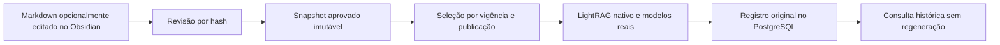

# Fonte canônica, LightRAG e registro de assessoramento — 04/11/2026

Leia `RESULTS.md` para resultados observados, `RESEARCH.md` para pesquisa/hipóteses e `COMMANDS.md` para reprodução. Esta é uma bancada de qualificação, não um deployment empresarial.

Permissão atual é exigida antes da recuperação e antes de consultar um registro antigo. A resposta é assessoramento de conhecimento, sem autorização de ferramenta ou ação empresarial. O snapshot de origem e os IDs das chamadas de modelo ficam vinculados ao registro.

Editorial TypeScript reaproveitado da rodada anterior; runtime LightRAG Python e storages reais. Não há novo dono de workflow: LangGraph continua o candidato único; esta rodada testa a API de conhecimento/registro, não reexecuta o controlador ou equipes multiagentes.

O vault é compatível com Markdown/Obsidian; a UI Obsidian continua não testada. Os exemplos de `Vault` são propostas de demonstração, sem publicar automaticamente. .state, pesos, caches e ambientes não integram o ZIP.
